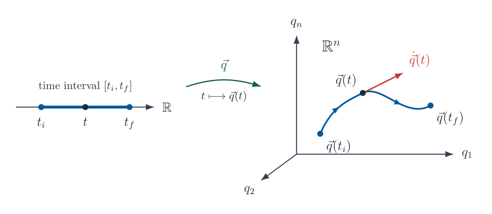

# Action Functional

>[!def] Lagrangian
> $$
> \mathcal{L} = T-V=\mathcal{L}(q,\dot{q},t)
> $$

>[!def] path
>A **path** is mathematically defined as
> $$
> \vec{q}(t):[t_{i},t_{f}]\to \mathbb{R}^{n}
> $$

>[!def] The Principle of Least Action
>**Action Functional**:
> $$
> S[\boldsymbol{q}(t)]:=\int_{t_{i}}^{t_{f}} \mathcal{L}(\boldsymbol{q},\boldsymbol{\dot{q}},t) \, \mathrm{d}t 
> $$
> **Principle of Least Action**:
> Often though not always, the action is minimized for classical trajectories, then this is the least action.

# Euler-Lagrange Equation

>[!done] Euler-Lagrange Equation
>If $\boldsymbol{q}(t)$ is the real path, then it obtains
> 
> $$
> \dfrac{\mathrm{d}}{\mathrm{d}t} \left( \dfrac{ \partial \mathcal{L} }{ \partial \dot{q}_{\alpha} }  \right)=\dfrac{ \partial \mathcal{L} }{ \partial q_{\alpha} } 
> $$

**Proof**.
Let $\delta S=0$. Using $\delta \dot{q}_{\alpha} = \dfrac{\mathrm{d}}{\mathrm{d}t}(\delta q_{\alpha})$ and integrating by parts:
$$
\begin{align}
\delta S[\boldsymbol{q}(t)]  & = \delta\int_{t_{i}}^{t_{f}} \mathcal{L}(\boldsymbol{q},\boldsymbol{\dot{q}},t) \, \mathrm{d}t  \\
 & =\sum_{\alpha} \int_{t_{i}}^{t_{f}} \left( \dfrac{ \partial \mathcal{L} }{ \partial \dot{q}_{\alpha} }\delta \dot{q}_{\alpha}+\dfrac{ \partial \mathcal{L} }{ \partial q_{\alpha} } \delta q_{\alpha}  \right) \, \mathrm{d}t \\
 & = \sum_{\alpha} \int_{t_{i}}^{t_{f}} \left[ \dfrac{\mathrm{d}}{\mathrm{d}t}\left( \dfrac{\partial \mathcal{L}}{\partial \dot{q}_{\alpha}} \delta q_{\alpha} \right) - \dfrac{\mathrm{d}}{\mathrm{d}t}\left( \dfrac{\partial \mathcal{L}}{\partial \dot{q}_{\alpha}} \right) \delta q_{\alpha} + \dfrac{\partial \mathcal{L}}{\partial q_{\alpha}} \delta q_{\alpha} \right] \, \mathrm{d}t \\
 & = \left. \sum_{\alpha} \dfrac{\partial \mathcal{L}}{\partial \dot{q}_{\alpha}} \delta q_{\alpha} \right|_{t_{i}}^{t_{f}} + \sum_{\alpha} \int_{t_{i}}^{t_{f}} \left[ \dfrac{\partial \mathcal{L}}{\partial q_{\alpha}} - \dfrac{\mathrm{d}}{\mathrm{d}t}\left( \dfrac{\partial \mathcal{L}}{\partial \dot{q}_{\alpha}} \right) \right] \delta q_{\alpha} \, \mathrm{d}t
\end{align}
$$
Since the endpoints are fixed, $\delta q_{\alpha}(t_{i}) = \delta q_{\alpha}(t_{f}) = 0$, so the boundary term vanishes:
$$
\delta S[\boldsymbol{q}(t)] = \sum_{\alpha} \int_{t_{i}}^{t_{f}} \left[ \dfrac{\partial \mathcal{L}}{\partial q_{\alpha}} - \dfrac{\mathrm{d}}{\mathrm{d}t}\left( \dfrac{\partial \mathcal{L}}{\partial \dot{q}_{\alpha}} \right) \right] \delta q_{\alpha} \, \mathrm{d}t = 0
$$
Since the variations $\delta q_{\alpha}(t)$ are arbitrary and independent for each $\alpha$ on $(t_{i}, t_{f})$, the integrand must vanish identically, yielding the Euler-Lagrange equation:
$$
\dfrac{\mathrm{d}}{\mathrm{d}t} \left( \dfrac{ \partial \mathcal{L} }{ \partial \dot{q}_{\alpha} }  \right)=\dfrac{ \partial \mathcal{L} }{ \partial q_{\alpha} }
$$

>[!done] Gauge Invariance
> Actually, the lagrangian is defined up to a total time derivative, meaning 
> $$
> \mathcal{L}'=\mathcal{L}+\dfrac{\mathrm{d}}{\mathrm{d}t} F(\boldsymbol{q},\boldsymbol{\dot{q}},t)
> $$
> yields the same equations of motion. This is called **gauge invariance**.

^a4dbb6

**Proof**.
Consider the action $S'[\boldsymbol{q}(t)]$ corresponding to $\mathcal{L}'$:
$$
S'[\boldsymbol{q}(t)] = \int_{t_{i}}^{t_{f}} \mathcal{L}'(\boldsymbol{q}, \boldsymbol{\dot{q}}, t) \, \mathrm{d}t = S[\boldsymbol{q}(t)] + \int_{t_{i}}^{t_{f}} \dfrac{\mathrm{d}}{\mathrm{d}t} F(\boldsymbol{q},\boldsymbol{\dot{q}},t) \, \mathrm{d}t
$$
Taking the variation of the total-derivative term yields
$$
\begin{align}
\delta \int_{t_{i}}^{t_{f}} \dfrac{\mathrm{d}}{\mathrm{d}t} F(\boldsymbol{q},\boldsymbol{\dot{q}},t) \, \mathrm{d}t & = \delta \int_{t_{i}}^{t_{f}} \, \mathrm{d}F = \delta \Big[ F(\boldsymbol{q}(t),\boldsymbol{\dot{q}}(t),t) \Big]_{t_{i}}^{t_{f}} \\
 & = \left. \sum_{\alpha} \left( \dfrac{\partial F}{\partial q_{\alpha}} \delta q_{\alpha} + \dfrac{\partial F}{\partial \dot{q}_{\alpha}} \delta \dot{q}_{\alpha} \right) \right|_{t_{i}}^{t_{f}}
\end{align}
$$
Since the endpoints are fixed, $\delta q_{\alpha}(t_{i}) = \delta q_{\alpha}(t_{f}) = 0$. For the standard gauge term $F = F(\boldsymbol{q}, t)$ (so $\dfrac{\partial F}{\partial \dot{q}_{\alpha}} = 0$, or when $\delta \dot{q}_{\alpha}|_{t_{i}}^{t_{f}} = 0$ as well), the boundary variation vanishes:
$$
\delta \int_{t_{i}}^{t_{f}} \dfrac{\mathrm{d}}{\mathrm{d}t} F \, \mathrm{d}t = 0
$$

