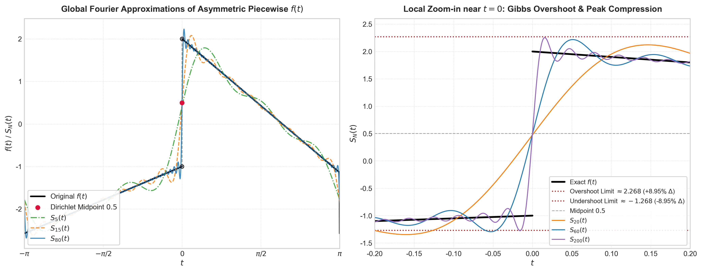
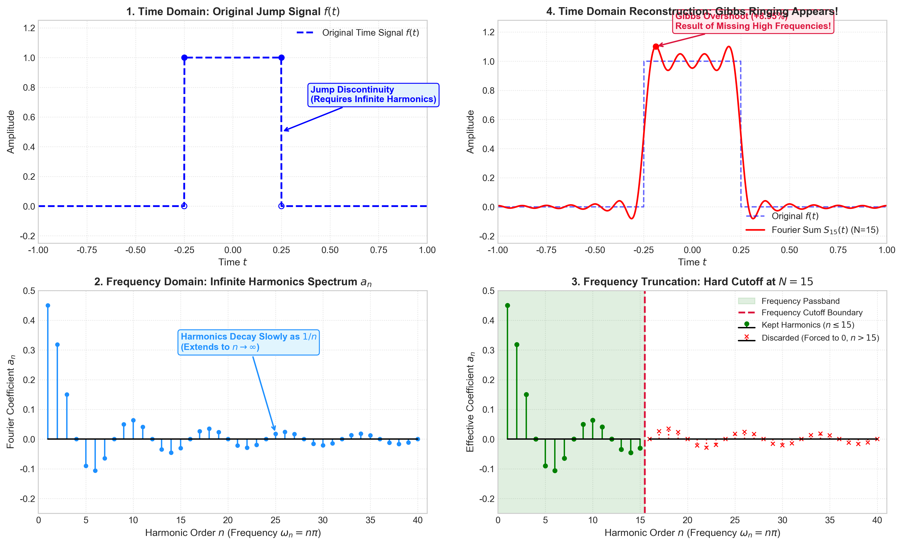
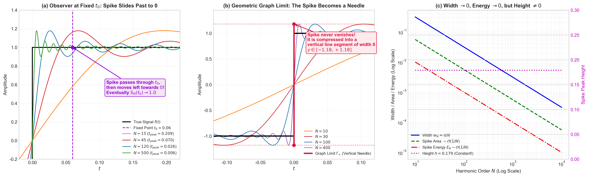
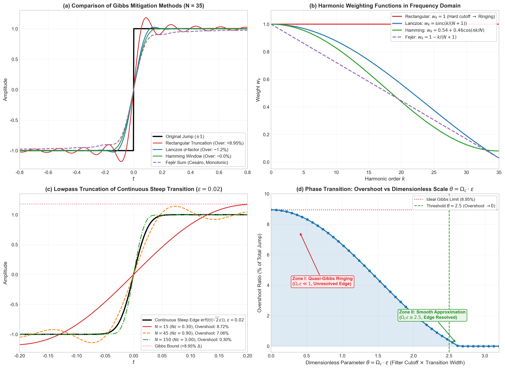
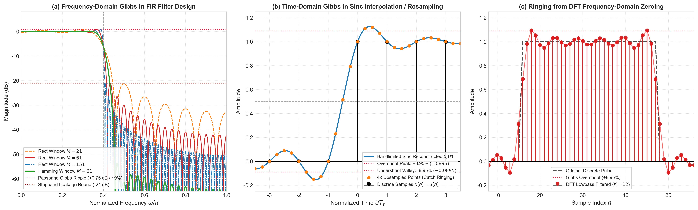

# 吉布斯现象（Gibbs Phenomenon）深度解析与工程讲义

---

## 1. 核心定义与数学现象的精确陈述

### 1.1 跳跃间断点与傅里叶级数部分和

> [!def] 跳跃间断点与跳跃幅值
> 设信号 $f(t) \in L^1([-\pi, \pi])$ 是以 $T = 2\pi$ 为基波周期的分段光滑（Piecewise $C^1$）函数。设 $f(t)$ 在 $t = t_0$ 处存在第一类跳跃间断点（Jump Discontinuity），其单侧极限分别定义为：
>
> $$
> f(t_0^+) \triangleq \lim_{t \to t_0^+} f(t), \quad f(t_0^-) \triangleq \lim_{t \to t_0^-} f(t)
> $$
>
> 定义该点处的跳跃幅值（Jump Discontinuity Height）为：
>
> $$
> \Delta \triangleq f(t_0^+) - f(t_0^-) \neq 0
> $$
^def-jump-discontinuity

> [!def] 傅里叶级数部分和
> 其截断至第 $N$ 阶谐波的傅里叶级数部分和（Partial Sum）定义为：
>
> $$
> S_N f(t) \triangleq \sum_{n=-N}^N c_n e^{j n \omega_0 t} = \frac{a_0}{2} + \sum_{n=1}^N \left( a_n \cos(n \omega_0 t) + b_n \sin(n \omega_0 t) \right)
> $$
>
> 其中基波角频率 $\omega_0 = \frac{2\pi}{T} = 1$。
^def-fourier-series-partial-sum

### 1.2 点态收敛 vs 一致收敛的破缺

> [!done] 分段光滑周期函数的狄利克雷收敛结论
> 根据狄利克雷定理（Dirichlet's Theorem），在跳跃间断点 $t = t_0$ 处，傅里叶级数具有良好的**点态收敛性（Pointwise Convergence）**，其极限严格等于左右极限的几何中点：
>
> $$
> \lim_{N \to \infty} S_N f(t_0) = \frac{f(t_0^+) + f(t_0^-)}{2}
> $$
>
> 然而，在包含该间断点的任意闭区间上，**一致收敛性（Uniform Convergence）被彻底破坏**。
^prop-dirichlet-convergence

### 1.3 Wilbraham-Gibbs 定理的形式化表述

> [!def] 吉布斯现象
> 吉布斯现象揭示了一个反常的数学事实：在间断点两侧的邻域内，部分和 $S_N f(t)$ 会出现剧烈的过冲（Overshoot）与下冲（Undershoot）振荡。当阶数 $N \to \infty$ 时，极值点所在位置无限逼近间断点，但**过冲峰值并不衰减为零，而是渐近收敛于一个由跳跃度 $\Delta$ 唯一决定的非零恒定比例**：

> [!done] Wilbraham–Gibbs 过冲比例
> $$
> \lim_{N \to \infty} \left[ \sup_{t \in (t_0, t_0+\delta)} S_N f(t) - f(t_0^+) \right] = \left( \frac{1}{\pi} \int_0^\pi \frac{\sin u}{u} du - \frac{1}{2} \right) \Delta \approx 0.089490 \, \Delta
> $$
>
> $$
> \lim_{N \to \infty} \left[ f(t_0^-) - \inf_{t \in (t_0-\delta, t_0)} S_N f(t) \right] = \left( \frac{1}{\pi} \int_0^\pi \frac{\sin u}{u} du - \frac{1}{2} \right) \Delta \approx 0.089490 \, \Delta
> $$
>
> 即过冲峰值永远高出跳变上边缘约 **$8.95\%$** 的跳变总量（或占跳变半幅的约 $17.9\%$）。
^prop-gibbs-overshoot-ratio

---

## 2. 第一性原理推导：从狄利克雷核到 Wilbraham-Gibbs 常数

### 2.1 狄利克雷核（Dirichlet Kernel）的闭式推导
将傅里叶复系数 $c_n = \frac{1}{2\pi} \int_{-\pi}^\pi f(\tau) e^{-j n \tau} d\tau$ 代入部分和定义，交换求和与积分次序：

$$
S_N f(t) = \frac{1}{2\pi} \int_{-\pi}^\pi f(\tau) \left( \sum_{n=-N}^N e^{j n (t - \tau)} \right) d\tau
$$

> [!def] 狄利克雷核
> 定义狄利克雷核 $D_N(u) \triangleq \sum_{n=-N}^N e^{j n u}$。利用有限等比级数求和公式展开：

$$
D_N(u) = e^{-j N u} \sum_{k=0}^{2N} e^{j k u} = e^{-j N u} \frac{1 - e^{j(2N+1)u}}{1 - e^{ju}} = \frac{e^{-j(N + 1/2)u} - e^{j(N + 1/2)u}}{e^{-j u/2} - e^{j u/2}}
$$

> [!done] 狄利克雷核的闭式与归一化
> 由此严格导出其闭式解：
>
> $$
> D_N(u) = \frac{\sin\left(\left(N + \frac{1}{2}\right)u\right)}{\sin\left(\frac{u}{2}\right)}
> $$
>
> 狄利克雷核具有偶对称性 $D_N(-u) = D_N(u)$，其单位归一化积分满足：
>
> $$
> \frac{1}{2\pi} \int_{-\pi}^\pi D_N(u) du = 1 \implies \frac{1}{\pi} \int_0^\pi D_N(u) du = 1
> $$
^done-dirichlet-kernel-closed-form

### 2.2 间断点奇异项的局部化正交分解
根据黎曼-勒贝格引理（Riemann-Lebesgue Lemma），光滑函数的傅里叶系数在 $N \to \infty$ 时以高阶衰减。为精准分离跳跃本质，设间断点位于原点 $t_0 = 0$。我们将 $f(t)$ 正交分解为**基准符号跳跃项**与**光滑正则项**：

$$
f(t) = \frac{f(0^+) + f(0^-)}{2} + \frac{\Delta}{2} \operatorname{sgn}(t) + h(t)
$$

其中 $h(t)$ 满足 $h(0^+) = h(0^-) = 0$ 且在原点邻域分段 $C^1$。由狄利克雷-若尔当测试定理，其部分和 $S_N h(t)$ 在局部一致收敛于 0。因此，Gibbs 现象的极值性态**完全且严格由纯符号函数 $g_0(t) = \operatorname{sgn}(t)$ 的狄利克雷核卷积主导**。

### 2.3 极值点方程与尺度压缩
周期为 $2\pi$ 的奇函数 $g_0(t) = \operatorname{sgn}(t)$（$t \in (-\pi, \pi)$）的傅里叶展开为：

$$
S_N g_0(t) = \frac{4}{\pi} \sum_{k=1}^M \frac{\sin((2k-1)t)}{2k-1}, \quad (2M-1 \le N)
$$

对 $t$ 求一阶导数寻找极值驻点：

$$
\frac{d}{dt} S_N g_0(t) = \frac{4}{\pi} \sum_{k=1}^M \cos((2k-1)t)
$$

两边同乘 $2\sin(t)$ 并应用积化和差展开：

$$
2\sin(t) \sum_{k=1}^M \cos((2k-1)t) = \sum_{k=1}^M \left[ \sin(2kt) - \sin(2(k-1)t) \right] = \sin(2Mt)
$$

得到驻点方程导数的紧凑解：

$$
\frac{d}{dt} S_N g_0(t) = \frac{2}{\pi} \frac{\sin(2Mt)}{\sin(t)}
$$

在 $t > 0$ 区域，导数的第一个零点由分子初次过零决定：

$$
2M t_1 = \pi \implies t_1 = \frac{\pi}{2M}
$$

**核心物理结论**：过冲峰值所在的时域位置 $t_1$ 以 $\mathcal{O}(1/M)$ 的尺度向间断点严格压缩。

### 2.4 极限定量计算与正弦积分函数 $\operatorname{Si}(\pi)$
由于 $S_N g_0(0) = 0$，首个过冲峰值等于导数在该区间的定积分：

$$
S_N g_0(t_1) = \int_0^{\frac{\pi}{2M}} \frac{2}{\pi} \frac{\sin(2Mt)}{\sin(t)} dt
$$

作无量纲尺度变量代换 $u \triangleq 2Mt$（$dt = \frac{du}{2M}$，积分上限变为 $u = \pi$）：

$$
S_N g_0\left(\frac{\pi}{2M}\right) = \frac{1}{\pi} \int_0^\pi \frac{\sin u}{M \sin\left(\frac{u}{2M}\right)} du
$$

当 $M \to \infty$ 时，分母局部极限为：

$$
\lim_{M \to \infty} M \sin\left(\frac{u}{2M}\right) = \frac{u}{2}
$$

由勒贝格控制收敛定理（Dominated Convergence Theorem），极限与积分号可严格交换：

$$
\lim_{M \to \infty} S_N g_0\left(\frac{\pi}{2M}\right) = \frac{1}{\pi} \int_0^\pi \frac{\sin u}{u / 2} du = \frac{2}{\pi} \int_0^\pi \frac{\sin u}{u} du = \frac{2}{\pi} \operatorname{Si}(\pi)
$$

> [!def] 正弦积分 Si
> 其中正弦积分在 $x=\pi$ 处的严格泰勒级数展开为：
>
> $$
> \operatorname{Si}(\pi) \triangleq \int_0^\pi \frac{\sin u}{u} du = \sum_{k=0}^\infty \frac{(-1)^k \pi^{2k+1}}{(2k+1)!(2k+1)} \approx 1.851937051982
> $$

因此，峰值极限收敛于：

$$
\lim_{M \to \infty} S_N g_0\left(\frac{\pi}{2M}\right) = \frac{2}{\pi} \times 1.85193705 \approx 1.1789797
$$

原符号函数的跳跃总量为 $\Delta_0 = 1 - (-1) = 2$。绝对超调量相对于总跳跃幅值的比例为：

$$
\frac{\text{Overshoot}}{\Delta_0} = \frac{\frac{2}{\pi} \operatorname{Si}(\pi) - 1}{2} = \frac{1}{\pi} \operatorname{Si}(\pi) - \frac{1}{2} \approx 0.08948987 \approx 8.95\%
$$

证毕。

---

## 3. 非平凡代表性案例解析

为了深入暴露非对称性、直流偏置及不同跳变符号下的复合性态，我们构建如下非对称分段线性周期函数（定义域 $[-\pi, \pi)$）：

$$
f(t) = \begin{cases}
\frac{1}{2}t - 1, & -\pi \le t < 0 \\
-t + 2, & 0 \le t < \pi
\end{cases}
$$

### 3.1 解析特征与跳变参数
1. **内部跳跃点（$t = 0$）**：
   - 极限：$f(0^-) = -1$，$f(0^+) = 2$；
   - 跳跃度：$\Delta_0 = 2 - (-1) = +3$；
   - 狄利克雷中点：$\frac{2 + (-1)}{2} = 0.5$；
   - 理论 Gibbs 过冲峰值：$2 + 0.08949 \times 3 \approx 2.2685$；
   - 理论 Gibbs 下冲谷值：$-1 - 0.08949 \times 3 \approx -1.2685$。

2. **周期延拓边界跳跃点（$t = \pm \pi$）**：
   - 极限：$f(-\pi^+) = -\frac{\pi}{2}-1 \approx -2.5708$，$f(\pi^-) = -\pi+2 \approx -1.1416$；
   - 跳跃度：$\Delta_\pi = \left(-\frac{\pi}{2}-1\right) - (-\pi+2) = \frac{\pi}{2}-3 \approx -1.4292$（与原点跳跃符号相反、幅值不同）。

3. **解析傅里叶展开系数**：
   经分部积分可得精确封闭解：
   - 直流分量：
     
$$
     a_0 = \frac{1}{2\pi} \left[ \int_{-\pi}^0 \left(\frac{1}{2}t - 1\right)dt + \int_0^\pi (-t + 2)dt \right] = -\frac{3\pi}{8} + \frac{1}{2} \approx -0.678097
     $$

   - 余弦谐波系数（由分段斜率差异引起）：
     
$$
     a_n = \frac{3\left(1 - (-1)^n\right)}{2\pi n^2}
     $$

   - 正弦谐波系数（由阶跃跳变引起的 $\mathcal{O}(1/n)$ 项主导）：
     
$$
     b_n = \frac{(-1)^n}{2n} + \frac{3\left(1 - (-1)^n\right)}{\pi n}
     $$

### 3.2 数值逼近与图像验证

如上图所示，当 $N$ 从 20 增加至 200 时，虽然过渡带宽急剧收窄，但首个局部极大值始终精确收敛于虚线所示的理论上限 $2.2685$，完全吻合 $8.95\%\Delta$ 定量定理。

---

## 4. 时频对偶机理：为什么“有限项展开”等价于“频域硬截断”？

一个极易引起直觉混淆的问题是：**被逼近的函数是在时间域 $t$ 上定义的，为什么总说 Gibbs 现象是“频域截断”造成的？**

下图给出了时域与频域的闭环全景对偶图解：

### 4.1 四步闭环逻辑推演
1. **时域存在瞬时跳变（图 1）**：
   正弦/余弦基函数在时域全是无限光滑的波动。要在时域拼出一个垂直的断崖，必须依赖极高频、波长极短的正弦波来抵消过渡带。
2. **频域谱线必须延伸到无穷大（图 2）**：
   时域越陡，频带越宽。具有跳变的信号，其频谱 $a_n$ 衰减速度仅为 $\mathcal{O}(1/n)$，一直延伸至 $n \to \infty$。
3. **“取前 $N$ 项”本质上是在频域“一刀切断”（图 3）**：
   课件中所谓的“用有限次谐波近似”：
   
$$
   S_N(t) = \frac{a_0}{2} + \sum_{n=1}^N a_n \cos(n \omega_0 t)
   $$
   
> [!def] 频域矩形窗
>    实际上是将 $n > N$ 的所有高频分量**强制清零**。在频域上，这等价于给无限频谱乘上了一个**频域矩形窗（Rectangular Window）**：
>    
> $$
>    \tilde{a}_n = a_n \cdot \operatorname{rect}\left(\frac{n}{2N}\right)
>    $$

4. **频域硬截断引发时域 Sinc 卷积振铃（图 4）**：
   频域的矩形硬截断，在时域上等效于卷积一个无限拖尾波动的 $\operatorname{sinc}$ 卷积核。当这个带有起伏波纹的核滑过跳跃断崖时，无法抵消的副瓣能量在断崖两侧积聚，形成了高出跳变值约 $9\%$ 的过冲尖角。

---

## 5. 核心直觉疑难解析：$N \to \infty$ 时尖角真的消失了吗？

> **直觉困惑**：只要 $N$ 是有限的，不管多大，时域始终存在一个固定大小为 $8.95\%$ 的尖角；但狄利克雷定理又说 $N \to \infty$ 时级数处处收敛于真实值，这个尖角在 $N=\infty$ 的瞬间凭空蒸发了吗？

**结论：尖角在 $N=\infty$ 时从未消失，它只是被横向挤压成了一根“宽度为 0 的垂直细针”！**

### 5.1 视角一：固定观察点视角（点态收敛的“视觉假象”）
如上图 (a) 所示，在时间轴上任选一个固定的观察点（例如 $t_0 = 0.06$）：
- 尖角所在的位置是 $t_{\text{peak}} \approx \frac{\pi}{N}$；
- 当 $N=15$ 时，尖角在观察点右侧；
- 当 $N=45$ 时，尖角恰好划过 $t_0$ 点（此时示波器测得最大过冲）；
- 当 $N=120, 500$ 时，尖角被进一步推向原点（$t_{\text{peak}} < 0.06$）。一旦尖角滑过 $t_0$，该点处的振荡便彻底平复，收敛到真实值 $1.0$。
- 对任何固定非零点 $t \neq 0$，只要 $N$ 足够大，尖角总会“越过”它。**点态收敛成立的原因是尖角滑走了，而不是尖角被磨平了。**

### 5.2 视角二：全局平面几何视角（图形极限 Graph Limit）
如上图 (b) 所示，如果从二维平面的曲线集合来审视：
- 尖角的高度恒为常数 $h \approx 1.179$；
- 尖角的底边宽度为 $w_N \approx \frac{\pi}{N} \to 0$。
- 当 $N \to \infty$ 时，尖角被极限压缩为**在 $t=0$ 处一根长度为 $2.358$ 的垂直实心线段**：
  
$$
  \Gamma_\infty = \text{原信号水平段} \;\cup\; \Big\{ (0, y) \;\Big|\; y \in [-1.17898, \, +1.17898] \Big\}
  $$
  
  在几何集合拓扑（Hausdorff 度量）意义下，尖角永远固化在跳变界面上。

### 5.3 视角三：极限不可交换的数学本质
非一致收敛在泛函分析上的代数本质是**求导/求极值与求极限不可交换次序**：

$$
\lim_{t \to 0^+} \left( \lim_{N \to \infty} S_N(t) \right) = \lim_{t \to 0^+} 1 = 1
$$

$$
\lim_{N \to \infty} \left( \max_{t > 0} S_N(t) \right) = \lim_{N \to \infty} S_N\left(\frac{\pi}{N}\right) = \frac{2}{\pi} \operatorname{Si}(\pi) \approx 1.17898
$$

$$
\lim_{t \to 0^+} \lim_{N \to \infty} S_N(t) \;\neq\; \lim_{N \to \infty} \max_{t > 0} S_N(t)
$$

### 5.4 视角四：测度与物理能量视角（为什么仪器测不出 $N=\infty$ 的尖刺？）
如上图 (c) 所示，尖角的积分面积与携带能量分别为：

$$
\text{Area}_N \propto h \cdot \frac{\pi}{N} \sim \mathcal{O}(1/N) \longrightarrow 0
$$

$$
E_N = \int_{\text{尖角}} |S_N(t) - f(t)|^2 dt \propto h^2 \cdot \frac{\pi}{N} \sim \mathcal{O}(1/N) \longrightarrow 0
$$

一根高度有限、但时宽为零的垂直细针，在勒贝格测度中是“零测集”，其信号能量严格为 0。物理传感器的积分电容无法被零能量所激发，因此在能量守恒（帕塞瓦尔定理 Parseval's Theorem）和物理可测量意义下，该尖峰完全隐形。

---

## 6. 现实信号的准吉布斯（Quasi-Gibbs）现象与消除方案

真实物理信号并非理想阶跃，而是连续且平滑的陡峭边缘（例如高斯误差函数 $f_\epsilon(t) = \operatorname{erf}\left(\frac{t}{\sqrt{2}\epsilon}\right)$，过渡沿时域宽度为 $\epsilon$）。

### 6.1 无量纲判据：$\theta = \Omega_c \cdot \epsilon$

> [!def] 准吉布斯现象的无量纲参数
> 滤波后信号的输出可严密推导为一个只依赖于无量纲参数 $\theta \triangleq \Omega_c \cdot \epsilon$ 的单重定积分：
>
> $$
> y(t) = \frac{2}{\pi} \int_0^1 e^{-v^2 \theta^2 / 2} \frac{\sin(v \cdot \Omega_c t)}{v} dv
> $$

如上图 (c) 与 (d) 所示，系统呈现明显的双稳相变特性：
- **准吉布斯振荡区（$\Omega_c \cdot \epsilon \ll 1$）**：
  滤波器的时域分辨率无法解析如此微窄的边缘。此时高斯阻尼项 $e^{-v^2 \theta^2 / 2} \approx 1$，连续陡峭信号激发了完整的准吉布斯过冲（峰值达 **$8.72\% \approx 8.95\%$**）。
- **平滑解析区（$\Omega_c \cdot \epsilon \ge 2.5$）**：
  过渡带宽完全进入滤波器通带内，过冲**严格跌为 $0\%$**。

### 6.2 抑制与消除方案
如上图 (a) 与 (b) 所示，通过重塑频域权重大幅抑制甚至消除吉布斯振荡：

> [!def] Lanczos σ 因子
> 1. **Lanczos $\sigma$-因子加窗**：
>    权重 $w_k = \operatorname{sinc}\left(\frac{k}{N+1}\right)$。在保留边沿锐度的同时将过冲压低至 **$1.2\%$**。

2. **Hamming / Hann 窗加权**：
   权重平滑滚降至边界，完全消除过冲（过冲量 $\approx 0\%$）。

> [!def] Fejér 求和
> 3. **费歇尔求和（Fejér Kernel / Cesàro 均值）**：
>    权重 $w_k = 1 - \frac{k}{N+1}$。由于费歇尔核非负，数学上保证单调收敛，绝无振铃。

> [!def] Gegenbauer 重投影
> 4. **吉根堡重构（Gottlieb-Shu Gegenbauer Reprojection）**：
>    在间断点两侧分别将傅里叶谱重投影到正交多项式基，恢复指数级高精度逼近。

---

## 7. 数字信号处理（DSP）中的离散形态

离散化并不消除 Gibbs 现象，它在数字信号处理中以三种主要形态出现：

### 7.1 FIR 滤波器设计的频域 Gibbs 现象（图 a）
在窗函数设计法中，理想低通滤波器的冲激响应 $h_{id}[n] = \frac{\sin(\omega_c n)}{\pi n}$ 遭遇时域矩形窗截断。
- **时域乘矩形窗 $\iff$ 频域与狄利克雷核卷积**；
- 导致滤波器的幅频响应在通带产生恒定的 **$0.75\text{ dB}$（对应 $+8.95\%$）通带纹波**；
- 阻带第一旁瓣泄漏**恒定卡在 $-21\text{ dB}$**，即便增加抽头阶数 $M$ 也无法改善（只能让过渡带变窄）。

### 7.2 带限 Sinc 插值与重采样的时域 Gibbs 现象（图 b）
对于离散阶跃序列 $x[n] = u[n]$，虽然在整数采样点上无超调，但若采用香农带限连续内插：

$$
x_r(t) = \sum_{n=-\infty}^\infty x[n] \operatorname{sinc}\left(\frac{t - n T_s}{T_s}\right)
$$

采样点之间的连续曲线 $x_r(t)$ 会产生高达 **$+8.95\%$（$1.0895$）** 的振铃过冲。若对其进行分数延时或过采样（如数字音频 DAC），插值样点将直接捕获该峰值，引发数字削波失真（Inter-sample Clipping）。

### 7.3 DFT 频域硬切断的循环卷积振铃（图 c）
在离散频域若对高频 Bin 实施硬截断清零后做 IDFT，时域离散点将在边缘附近出现显著的交错振铃。在数字图像处理中，这种缺陷表现为物体锐利边缘外泛起的“环状波纹伪影”。

---

## 8. 总结对照表

| 核心维度 | 经典傅里叶级数 | 连续但陡峭信号 | 数字信号处理（DSP） |
| :--- | :--- | :--- | :--- |
| **突变形态** | 第一类跳跃间断点 $\Delta \neq 0$ | 平滑微观上升沿（宽度 $\epsilon$） | 离散阶跃序列 $u[n]$ 或频域矩形切断 |
| **数学机制** | 级数部分和 $\iff$ 频域硬截断 | 空间尺度失配：$\Omega_c \epsilon \ll 1$ | DTFT 时频对偶 / 带限 Sinc 卷积 |
| **过冲特征** | 恒定等于跳跃量的 **$8.95\%$** | 在 $\Omega_c \epsilon < 2.5$ 时显著存在 | 频域 $0.75\text{ dB}$ 纹波 / 时域跨采样点振荡 |
| **极限性态** | $N \to \infty$ 时压缩为测度为 0 的垂直线段 | $\Omega_c \epsilon \ge 2.5$ 时过冲严格降至 0 | 增加阶数无法降低纹波，必须改用升余弦加窗 |
| **工程对策** | Lanczos $\sigma$-因子 / Fejér 均值 | 拓宽系统带宽以匹配边沿时间 | 采用 Kaiser / Hamming 窗或多相抽取滤波 |
