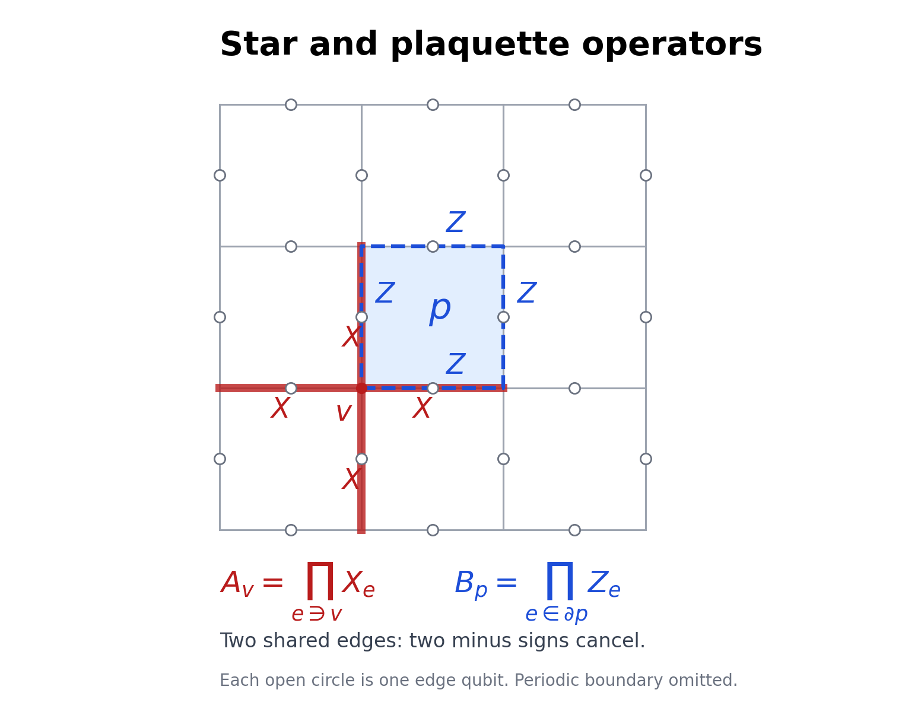

---
tags:
  - 待整理
aliases:
  - Pauli 群与稳定子码
---

# Pauli 群与稳定子码

## 从 Pauli 矩阵到 Pauli 群

> [!def] 量子比特与计算基
> 一个**量子比特**（qubit）的状态空间是 $\mathbb C^2$，取**计算基**
>
> $$
> |0\rangle=\begin{pmatrix}1\\0\end{pmatrix},\qquad
> |1\rangle=\begin{pmatrix}0\\1\end{pmatrix}.
> $$
>
> 归一化纯态为 $\alpha|0\rangle+\beta|1\rangle$，$|\alpha|^2+|\beta|^2=1$。$n$ 比特空间为[[量子力学/基础与演化/基础公设#^def-composite-tensor-space|张量积]] $(\mathbb C^2)^{\otimes n}$，计算基写为 $|b_1\cdots b_n\rangle$，其中每个 $b_j\in\{0,1\}$。

采用[[Group/1. Foundations/1. Basic Definitions and Examples#四元数群与 Pauli 矩阵|Pauli 矩阵]] $X=\sigma_1,Y=\sigma_2,Z=\sigma_3$，直接作用于两列基向量得到

$$
X|0\rangle=|1\rangle,\quad X|1\rangle=|0\rangle,\qquad
Z|0\rangle=|0\rangle,\quad Z|1\rangle=-|1\rangle.
$$

> [!def] 位翻转、相位翻转与局域算符
> 作用 $X$ 称为**位翻转**（bit flip）；作用 $Z$ 称为**相位翻转**（phase flip）。$X_j$ 或 $Z_j$ 表示仅在第 $j$ 个比特上作用相应算符、其余位置作用恒等算符。
> 对张量积算符，$(A_1\otimes\cdots\otimes A_n)|b_1\cdots b_n\rangle=(A_1|b_1\rangle)\otimes\cdots\otimes(A_n|b_n\rangle)$。

> [!def] Pauli 群
> 单比特 **Pauli 群**为
>
> $$
> P_1=\{i^kA:k\in\{0,1,2,3\},\ A\in\{I_2,X,Y,Z\}\}
> =\langle X,Y,Z\rangle.
> $$
>
> $n$ 比特 Pauli 群为
>
> $$
> P_n=\{i^kA_1\otimes\cdots\otimes A_n:
> k\in\{0,1,2,3\},\ A_j\in\{I_2,X,Y,Z\}\}.
> $$

> [!done] Pauli 群的阶与交换性质
> $|P_n|=4^{n+1}$。任意两个 Pauli 群元素或者交换，或者反交换；任意 $g\in P_n$ 都满足 $g^2=\pm I$，且是酉矩阵。

单比特乘积由已有 [[量子力学/角动量与自旋/Pauli Metrics|Pauli 乘法关系]] 化成 $\pm1,\pm i$ 乘一个 $I_2,X,Y,Z$，例如 $XY=iZ$、$XYZ=iI_2$，因此连同相位后封闭。多比特逐个位置相乘，不同位置互相交换，所有相位归并成一个整体 $i^k$。共有 $4^n$ 种不同 Pauli 字串，每种四个不同相位；字串在线性空间中彼此独立，故计数不重复。两个字串换序时，每个位置贡献一个正负号，相乘后仍是正负号。

## 稳定子如何选出编码空间

> [!def] 稳定子群与稳定子码（Definition 2.27）
> 设 $S\le P_n$ 是不含 $-I$ 的阿贝尔子群。称 $S$ 为**稳定子群**，其共同 $+1$ 本征空间
>
> $$
> \mathcal C=\{|\psi\rangle:g|\psi\rangle=|\psi\rangle\text{ 对所有 }g\in S\}
> $$
>
> 称为**编码空间**，这一编码称为**稳定子码**（stabilizer code）。只需对一组生成元施加条件，其余群元素的条件便自动成立。

> [!done] 稳定子元素是可同时测量的厄米对合
> 若 $S$ 满足上述定义，则每个 $g\in S$ 都满足 $g^2=I$ 和 $g^\dagger=g$，其本征值属于 $\{+1,-1\}$。这些算符相互交换，因而在有限维空间中有共同的正交本征基。

因为 $g^2\in S$ 且只能为 $\pm I$，排除 $-I$ 后必须为 $I$。又因 $g$ 酉，$g^\dagger=g^{-1}=g$。可以先对角化一个厄米算符；与它交换的其他算符保持它的每个本征子空间，再分别对角化，如此得到共同本征基。若 $-I\in S$，稳定条件将要求 $-|\psi\rangle=|\psi\rangle$，只剩零向量。

> [!def] 独立稳定子生成元
> 稳定子群的一组生成元 $g_1,\ldots,g_r$ 称为**独立**，是指 $g_1^{a_1}\cdots g_r^{a_r}=I$、$a_j\in\{0,1\}$ 只能在所有 $a_j=0$ 时成立。

> [!done] 稳定子编码空间的维数（本页计数工具）
> 若 $n$ 比特稳定子群有 $r$ 个独立生成元，则
>
> $$
> \Pi_{\mathcal C}=\prod_{j=1}^{r}\dfrac{I+g_j}{2}
> =\dfrac{1}{2^r}\sum_{g\in S}g,\qquad
> \dim\mathcal C=2^{n-r}.
> $$

每个 $(I+g_j)/2$ 投影到 $g_j$ 的 $+1$ 本征空间；投影互相交换，乘积投影到交集。独立性保证展开中的 $2^r$ 个群元素互异。除了 $I$ 以外，每个稳定子元素都至少含一个无迹 Pauli 因子，所以迹为零；$I$ 的迹为 $2^n$。因此 $\operatorname{tr}\Pi_{\mathcal C}=2^{n-r}$。这同时说明各条件相容，编码空间非零。

## 错误伴随式

> [!def] Pauli 错误的伴随式
> 固定稳定子生成元 $g_1,\ldots,g_r$。对 $E\in P_n$，由 $g_jE=s_jEg_j$ 定义 $s_j\in\{+1,-1\}$。列表 $(s_1,\ldots,s_r)$ 称为 $E$ 的**错误伴随式**（error syndrome）。

若 $|\psi\rangle\in\mathcal C$，那么

$$
g_j(E|\psi\rangle)=s_jEg_j|\psi\rangle=s_jE|\psi\rangle.
$$

因此测量 $g_j$ 时得到 $s_j$，它由错误 $E$ 决定，与编码态中的 $\alpha,\beta$ 无关。这里只分析 Pauli 错误：$I,X,Y,Z$ 构成单比特算符空间的一组基，因此一般局域误差的分析可由这些算符展开，但本节不以此代替一般量子纠错条件。

## 三比特重复码（Example 2.28）

取 $S=\langle Z_1Z_2,Z_2Z_3\rangle$，其中 $Z_1Z_2=Z\otimes Z\otimes I_2$、$Z_2Z_3=I_2\otimes Z\otimes Z$。两生成元交换，平方为 $I$，乘积为 $Z_1Z_3$，故

$$
S=\{I,Z_1Z_2,Z_2Z_3,Z_1Z_3\}\cong V_4.
$$

在基态 $|b_1b_2b_3\rangle$ 上，$Z_iZ_j$ 的本征值为 $(-1)^{b_i+b_j}$。两个稳定条件要求 $b_1=b_2$ 且 $b_2=b_3$，只留下 $|000\rangle,|111\rangle$。

> [!def] 三比特重复码的逻辑基
> 本例用 $|0_L\rangle=|000\rangle$、$|1_L\rangle=|111\rangle$ 表示一个被编码的逻辑比特，其编码空间为 $\mathcal C=\operatorname{span}\{|0_L\rangle,|1_L\rangle\}$。下标 $L$ 表示逻辑态。

对 $|\psi_L\rangle=\alpha|000\rangle+\beta|111\rangle$，利用 $XZ=-ZX$ 逐项计算：

| 错误 $E$ | $Z_1Z_2$ | $Z_2Z_3$ | 恢复操作 |
| --- | --- | --- | --- |
| $I$ | $+1$ | $+1$ | $I$ |
| $X_1$ | $-1$ | $+1$ | $X_1$ |
| $X_2$ | $-1$ | $-1$ | $X_2$ |
| $X_3$ | $+1$ | $-1$ | $X_3$ |

例如 $X_1|\psi_L\rangle=\alpha|100\rangle+\beta|011\rangle$，两项对 $Z_1Z_2$ 都给 $-1$，对 $Z_2Z_3$ 都给 $+1$。理想的这些稳定子测量只投影到整个共同本征空间，不分辨该空间内部的两项，故保留 $\alpha,\beta$。随后再施加 $X_1$，由 $X_1^2=I$ 恢复原态。

> [!done] 三比特重复码的纠错范围（Remark 2.29）
> 在至多发生一次位翻转的假设下，上述伴随式唯一确定错误，恢复后得到原编码态。该码不能纠正任意单比特错误；尤其任一 $Z_j$ 相位翻转都产生平凡伴随式 $(+1,+1)$，却可能改变逻辑态。

例如 $Z_1$ 与两个生成元交换，但 $Z_1\notin S$，并且

$$
Z_1|\psi_L\rangle=\alpha|000\rangle-\beta|111\rangle.
$$

相同的现象发生在 $Z_2,Z_3$。伴随式相同不表示错误总能忽略。

> [!done] 独立翻转模型下的逻辑错误概率
> 若三个物理比特各以概率 $p$ 独立发生位翻转，并按上表恢复，逻辑位错误概率为 $3p^2(1-p)+p^3=3p^2-2p^3$。
> 若仅考虑各比特独立以概率 $p$ 发生相位翻转，逻辑相位错误概率为 $3p(1-p)^2+p^3=3p-6p^2+4p^3$。

位翻转出错对应至少两个物理位翻转；相位翻转出错对应奇数次相位翻转。小 $p$ 下，前者约 $3p^2$，后者约 $3p$，所以是否有益取决于实际噪声类型。

原讲义进一步指出：Shor 九比特码将防位翻转与防相位翻转的编码组合起来；在编码一个逻辑比特、精确纠正任意单个物理比特错误的量子比特码中，五比特是最小长度。这两个更大编码的构造未在原章展开，参见章末 Nielsen–Chuang 书目。

## 环面码（Example 2.30）

> [!def] 环面方格、星算符、面算符与环面码
> 将方形网格的左、右边界对应粘合，上、下边界对应粘合，得到**环面**上的周期方格。在每条边 $e$ 放一个量子比特。对每个顶点 $v$ 和每个面 $p$，定义
>
> $$
> A_v=\prod_{e\ni v}X_e,\qquad
> B_p=\prod_{e\in\partial p}Z_e.
> $$
>
> $A_v$ 称为**星算符**，作用于接在 $v$ 上的四条边；$B_p$ 称为**面算符**，作用于 $p$ 边界的四条边。由它们生成的稳定子群所定义的编码称为**环面码**（toric code）。

图中每条边中点的圆圈代表一个比特；边界周期粘合未画出。红色星与蓝色面共享两条边。绘图代码：[[Group/1. Foundations/assets/toric_code.py|toric_code.py]]。

> [!done] 环面码的对易性、生成元关系与非零编码空间
> 所有 $A_v,B_p$ 两两交换，且
>
> $$
> \prod_v A_v=I,\qquad \prod_p B_p=I.
> $$
>
> 由它们生成的群不含 $-I$，因此确实满足稳定子码的定义。

两个星算符只含 $X$，两个面算符只含 $Z$，所以分别交换。星与面要么没有公共边，要么恰有两条公共边；后一种情形换序产生 $(-1)^2=1$。

**Quiz 2.5 的解答：** 所有星算符相乘时，每条边恰被它的两个端点各计一次，得到 $X_e^2=I$；所有面算符相乘时，每条边也被相邻两个面各计一次，得到 $Z_e^2=I$。

为补足“不含 $-I$”这一条件，从所有边均为 $|0\rangle$ 的态出发，施加 $\prod_v(I+A_v)$。展开是若干计算基态的正系数之和，包含原态，故非零。每个 $A_v$ 固定这个和；每个 $B_p$ 固定原态，且与所有 $A_v$ 交换，也固定这个和。因此存在非零共同 $+1$ 本征态，$-I$ 不可能属于生成群。

> [!def] 环面码 Hamiltonian
> 本例的 Hamiltonian 取为 $H=-\sum_v A_v-\sum_p B_p$，即每个星、面的耦合系数都设为 $1$。最低能量的本征子空间称为**基态空间**。

> [!done] 环面码的基态简并度
> 对周期 $L\times L$ 方格，$L\ge2$，编码空间恰为 $H$ 的基态空间，维数恒为 $4$。

设顶点数和面数均为 $N=L^2$，边数为 $2N$。每项取 $+1$ 时能量最低，且前面已证明这些条件可同时满足，所以基态空间就是编码空间。

星算符的独立关系只有“全部星的乘积为 $I$”：若某些星的乘积为 $I$，每条边两端所选顶点数必须为偶数，意味着边两端要么都选、要么都不选；图连通，故只能全选或全不选。面算符的论证相同：相邻两面必须同选同不选。混合星与面不能额外产生恒等关系，因为在任一边上，$X$ 和 $Z$ 的非零幂即使同时出现也只会成为带相位的 $Y$，不会变成 $I$。

因此独立稳定子数为 $2N-2$。由前面的维数公式，

$$
\dim\mathcal C=2^{2N-(2N-2)}=4.
$$

### 曲面依赖与逻辑环

> [!def] Euler 示性数与曲面亏格
> 对由顶点、边和圆盘状面组成的有限曲面剖分，记其数量为 $V,E,F$，定义 **Euler 示性数** $\chi=V-E+F$。对连通闭合可定向曲面，**亏格** $g$ 表示把球面加上多少个柄；球面 $g=0$，环面 $g=1$。

> [!done] 闭合可定向曲面上的编码维数
> 在连通闭合可定向曲面的连通胞腔剖分上使用同样的边比特、星和面稳定子，且面为圆盘，则独立条件数为 $V+F-2$，从而
>
> $$
> \dim\mathcal C=2^{E-V-F+2}=2^{2-\chi}=4^g.
> $$
>
> 最后一步采用闭合可定向曲面的 $\chi=2-2g$；球面给出 $1$ 维，环面给出 $4$ 维。

关系数的论证与上面的连通网格相同。曲面的分类和 $\chi=2-2g$ 是原讲义采用的拓扑事实，本章不作其证明。

> [!def] 环面码的两个逻辑 $Z$ 环
> 分别沿环面两个基本周期方向，选一条由网格边组成的闭合路径，并将该路径上所有 $Z_e$ 相乘，得到 $\overline Z_1,\overline Z_2$。它们称为本例的两个**逻辑 $Z$ 算符**。

每条闭合路径在顶点处进入和离开，故与星算符重叠偶数条边；它只含 $Z$，也与所有面算符交换。沿周期方向绕一圈的路径不能写成面边界的和，因此相应算符不是稳定子乘积。两个独立的本征值 $\pm1$ 给出四种符号对，标记四维基态空间的一组基，其标签集合对应 $\mathbb Z_2\times\mathbb Z_2$。

## 原讲义参考文献

- M. A. Nielsen、I. L. Chuang，*Quantum Computation and Quantum Information*，10th Anniversary，Cambridge University Press，2010，§10.5。
- A. Y. Kitaev，*Fault-tolerant quantum computation by anyons*，Annals of Physics 303（2003），2；arXiv: quant-ph/9707021。
- S. H. Simon，*Topological Quantum: Lecture Notes and Proto-Book*，2021，chs. 24–25；后出版为 *Topological Quantum*，Oxford University Press，2023。原 PDF 第 22 页保留了讲义下载地址。
