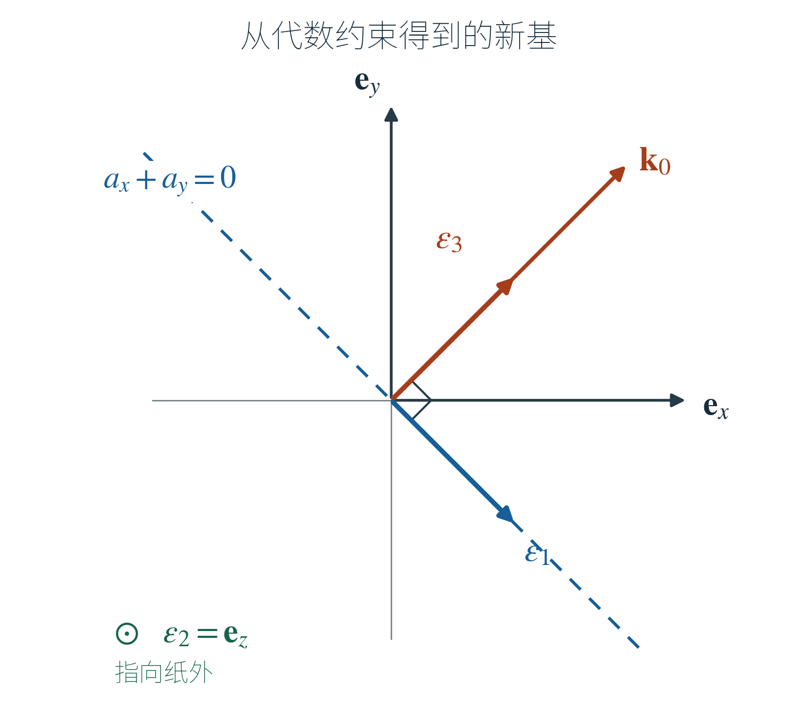
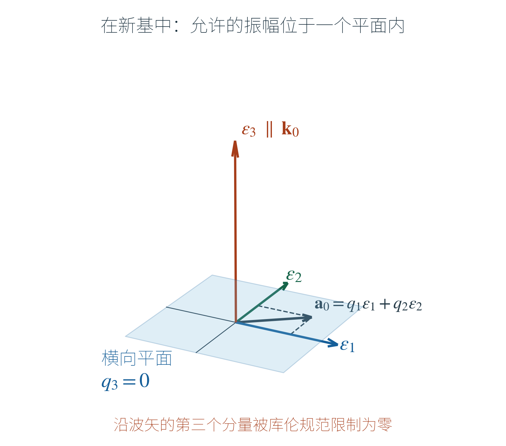

## 1. 先取一个具体波矢

沿用教材 5.1.27—5.1.49 已经得到的起点：腔内无电荷、无电流，研究不含均匀静场的辐射部分。教材用矢势 $\mathbf A(\mathbf r,t)$ 和标势 $\phi(\mathbf r,t)$ 表示电磁场，其关系为

$$
\mathbf B=\nabla\times\mathbf A,\qquad
\mathbf E=-\nabla\phi-\dfrac1c\partial_t\mathbf A,
$$

其中 $\mathbf E$ 是电场，$\mathbf B$ 是磁感应强度，$c$ 是真空光速，$\dfrac1c$ 因子沿用教材的单位约定。取散度为零的矢势（库伦规范），并在这一辐射问题中取 $\phi=0$。教材在这些条件下已推得

$$
\partial_t^2\mathbf A=c^2\nabla^2\mathbf A,
\qquad \nabla\cdot\mathbf A=0.
$$

第一式控制时间演化，第二式限制允许的解。以下仍在经典场论中，所有振幅都是数，不是量子算符。

### 1.1 空间波形与矢量振幅分开

取边长为 $L$ 的周期立方盒，体积 $V=L^3$，先写出整个矢势的空间 Fourier 展开。

> [!def] 矢势的 Fourier 展开与矢量振幅
> 周期立方盒中的允许波矢为 $\mathbf k=\dfrac{2\pi}{L}(n_x,n_y,n_z)$，其中 $n_x,n_y,n_z\in\mathbb Z$。令 $\psi_{\mathbf k}(\mathbf r)=\dfrac1{\sqrt V}e^{i\mathbf k\cdot\mathbf r}$，则辐射部分展开为
> $$
> \mathbf A(\mathbf r,t)
> =\sum_{\mathbf k\ne0}\mathbf a_{\mathbf k}(t)\psi_{\mathbf k}(\mathbf r)
> =\dfrac1{\sqrt V}\sum_{\mathbf k\ne0}\mathbf a_{\mathbf k}(t)e^{i\mathbf k\cdot\mathbf r}.
> $$
> 在每个分离变量项 $\mathbf a_{\mathbf k}(t)\psi_{\mathbf k}(\mathbf r)$ 中，小写 $\mathbf a_{\mathbf k}(t)$ 表示时间部分的分离变量函数，也就是该波矢对应的矢量振幅；$\psi_{\mathbf k}(\mathbf r)$ 表示空间部分。固定 $\mathbf k$ 后，$\mathbf a_{\mathbf k}$ 只依赖时间，其三个分量可以是复数。求和包含全部非零允许波矢。
^def-vector-fourier-amplitude

下面从总展开中选取一个 Fourier 分量，即波矢

$$
\mathbf k_0=\kappa(1,1,0),\qquad
\kappa=\dfrac{2\pi}{L},\qquad
k_0=\lvert\mathbf k_0\rvert=\sqrt2\kappa
$$

对应的这一项。简记 $\mathbf a_0(t)=\mathbf a_{\mathbf k_0}(t)$、$\psi_0(\mathbf r)=\psi_{\mathbf k_0}(\mathbf r)$，于是

$$
\mathbf A^{[\mathbf k_0]}(\mathbf r,t)
=\mathbf a_0(t)\psi_0(\mathbf r),\qquad
\psi_0(\mathbf r)=\dfrac1{\sqrt V}e^{i\kappa(x+y)}.
$$

这里的上标 $[\mathbf k_0]$ 只标记所取的一项。实际矢势为实值时，要把它与 $-\mathbf k_0$ 的项配对；先求这一项，最后再处理实值条件。

> [!def] 笛卡尔基矢与坐标分量
> 固定原来的三个笛卡尔单位基矢
> $$
> \mathbf e_x=\begin{pmatrix}1\\0\\0\end{pmatrix},\qquad
> \mathbf e_y=\begin{pmatrix}0\\1\\0\end{pmatrix},\qquad
> \mathbf e_z=\begin{pmatrix}0\\0\\1\end{pmatrix}.
> $$
> 振幅写为 $\mathbf a_0=a_x\mathbf e_x+a_y\mathbf e_y+a_z\mathbf e_z$，其坐标列为 $\begin{pmatrix}a_x&a_y&a_z\end{pmatrix}^{\mathsf T}$。$\mathsf T$ 表示转置。
^def-cartesian-direction-basis

这里的 $\mathbf e$ 始终表示原来的笛卡尔基矢；稍后选出的新基矢统一记为 $\boldsymbol\epsilon$。大写 $\mathbf A(\mathbf r,t)$ 表示总矢势，小写 $\mathbf a_{\mathbf k}(t)$ 表示每个 Fourier 项的矢量振幅。

由于 $\partial_x\psi_0=i\kappa\psi_0$、$\partial_y\psi_0=i\kappa\psi_0$、$\partial_z\psi_0=0$，有

$$
\nabla^2\psi_0=-2\kappa^2\psi_0.
$$

代入波动方程并约去 $\psi_0$，得到

$$
\ddot{\mathbf a}_0+\omega_0^2\mathbf a_0=0,
\qquad \omega_0=ck_0=\sqrt2c\kappa.
$$

这确实就是三个互不耦合的方程：

$$
\ddot a_x+\omega_0^2a_x=0,\qquad
\ddot a_y+\omega_0^2a_y=0,\qquad
\ddot a_z+\omega_0^2a_z=0.
$$

但是，库伦规范还要求

$$
0=\nabla\cdot(\mathbf a_0\psi_0)
=i\kappa(a_x+a_y)\psi_0,
$$

所以必须另有 $a_x+a_y=0$。三个运动方程虽然可以分别求解，它们的解不能任意拼接：例如初值必须满足 $a_x(0)+a_y(0)=0$ 和 $\dot a_x(0)+\dot a_y(0)=0$，才能使约束在全部时间成立。

### 1.2 从库伦规范的代数约束求出新基矢

先只看已经得到的约束 $a_x+a_y=0$。解出 $a_y=-a_x$，便有

$$
\mathbf a_0
=a_x(\mathbf e_x-\mathbf e_y)+a_z\mathbf e_z.
$$

这一步已经给出了两个独立方向：$\mathbf e_x-\mathbf e_y$ 和 $\mathbf e_z$。它们的点积为零，长度分别为 $\sqrt2$ 和 $1$，所以将它们归一化，取

$$
\boldsymbol\epsilon_1=\dfrac{\mathbf e_x-\mathbf e_y}{\sqrt2},\qquad
\boldsymbol\epsilon_2=\mathbf e_z.
$$

这两个方向来自约束方程的通解。现在只需补上第三个单位方向，使它与前两个方向都正交。设这个待求方向为

$$
\mathbf u=u_x\mathbf e_x+u_y\mathbf e_y+u_z\mathbf e_z.
$$

两个正交条件分别给出

$$
\mathbf u\cdot\boldsymbol\epsilon_1=\dfrac{u_x-u_y}{\sqrt2}=0,\qquad
\mathbf u\cdot\boldsymbol\epsilon_2=u_z=0.
$$

因此 $u_x=u_y$、$u_z=0$。归一化并选取两个非零分量均为正的那个方向，得到

$$
\boldsymbol\epsilon_3=\dfrac{\mathbf e_x+\mathbf e_y}{\sqrt2}.
$$

至此，三个新基矢完全由约束方程及正交归一化求出：

$$
\boldsymbol\epsilon_1=\dfrac1{\sqrt2}\begin{pmatrix}1\\-1\\0\end{pmatrix},\qquad
\boldsymbol\epsilon_2=\begin{pmatrix}0\\0\\1\end{pmatrix},\qquad
\boldsymbol\epsilon_3=\dfrac1{\sqrt2}\begin{pmatrix}1\\1\\0\end{pmatrix}.
$$

这是一组方便的选择。库伦规范确定了允许振幅的两个独立方向所张成的空间，但并不唯一固定其中的一组基矢；将前两个基矢再作其他正交组合也可以。

> [!def] 新基底下的振幅分量
> 对上面求得的实正交归一基，定义
> $$
> q_s(t)=\boldsymbol\epsilon_s\cdot\mathbf a_0(t),\qquad s=1,2,3.
> $$
> 下标 $s$ 只标记第几个新基矢，$q_s$ 是对应的标量分量。
^def-new-basis-amplitudes

具体算出

$$
q_1=\dfrac{a_x-a_y}{\sqrt2},\qquad
q_2=a_z,\qquad
q_3=\dfrac{a_x+a_y}{\sqrt2}.
$$

根据 [[量子力学/Hilbert空间/简介#^prop-orthonormal-expansion|正交归一基展开]]，同一个振幅也就写成

$$
\mathbf a_0=q_1\boldsymbol\epsilon_1+q_2\boldsymbol\epsilon_2+q_3\boldsymbol\epsilon_3.
$$

展开回旧基矢后，

$$
a_x=\dfrac{q_1+q_3}{\sqrt2},\qquad
a_y=\dfrac{-q_1+q_3}{\sqrt2},\qquad
a_z=q_2.
$$

于是原来的约束 $a_x+a_y=0$ 变成 $q_3=0$。它不要求 $a_x,a_y$ 分别为零，而是要求它们互为相反数。

### 1.3 剩下的两个振幅怎样运动

对 $q_1=\dfrac{a_x-a_y}{\sqrt2}$ 求两次时间导数：

$$
\ddot q_1
=\dfrac{\ddot a_x-\ddot a_y}{\sqrt2}
=-\omega_0^2\dfrac{a_x-a_y}{\sqrt2}
=-\omega_0^2q_1.
$$

同样，$q_2=a_z$ 给出 $\ddot q_2=-\omega_0^2q_2$。用 [[数理方法/Homework5/阻尼振动ODE#含阻尼项的常系数二阶ODE（特征方程法）|二阶常系数方程的特征方程法]]，令 $q_s=e^{rt}$，得到 $r^2+\omega_0^2=0$，两根为 $r=\pm i\omega_0$。因此

$$
q_1(t)=C_1\cos\omega_0t+S_1\sin\omega_0t,\qquad
q_2(t)=C_2\cos\omega_0t+S_2\sin\omega_0t,
$$

其中 $C_1,S_1,C_2,S_2$ 是由该 Fourier 项初值决定的复常数。该项的允许解为

$$
\mathbf A^{[\mathbf k_0]}(\mathbf r,t)
=\big[q_1(t)\boldsymbol\epsilon_1+q_2(t)\boldsymbol\epsilon_2\big]
\dfrac{e^{i\kappa(x+y)}}{\sqrt V}.
$$

例如，取 $q_1(t)=C\cos\omega_0t$、$q_2(t)=0$，其中 $C$ 为实常数，并加入共轭的 $-\mathbf k_0$ 项，得到实值场

$$
\mathbf A_{\mathrm{pair}}(\mathbf r,t)
=\dfrac{2C}{\sqrt V}\boldsymbol\epsilon_1
\cos\omega_0t\cos\big[\kappa(x+y)\big].
$$

其 $\mathbf e_x,\mathbf e_y$ 分量互为相反数；直接计算 $\partial_x A_x+\partial_y A_y$，两项会相消。

## 2. 用这个例子读懂教材的本征矢与完备性

### 2.1 本征方程在这里究竟求了什么

把运动方程写作 $\ddot{\mathbf a}_0=-D_0\mathbf a_0$，则

$$
D_0=\omega_0^2I_3.
$$

这里 $I_3$ 是保持任意三维向量不变的单位矩阵。代入试探解 $\mathbf a_0=\mathbf u e^{-i\lambda t}$，得到

$$
D_0\mathbf u=\lambda^2\mathbf u.
$$

只要 $\mathbf u\ne0$，便有 $\lambda^2=\omega_0^2$。任意方向都满足这个本征方程，包括刚才选出的 $\boldsymbol\epsilon_1,\boldsymbol\epsilon_2,\boldsymbol\epsilon_3$。三个线性无关方向对应同一个本征值，这正是 [[量子力学/Hilbert空间/简介#本征态、谱与期望值|三重简并]] 的含义。

这里的本征值是 $\lambda^2$；时间因子还包含 $\lambda=\pm\omega_0$ 两种符号。上一节的正弦、余弦解已将两种时间因子包括在内。

所以这一步选取本征基的自由很大：运动方程没有挑出某组特殊基矢。我们利用库伦规范先求出允许振幅的两个基矢，再补成三维基底，使规范条件化为一个分量等于零。

### 2.2 把方向作为列排起来

定义这个例子的换基矩阵与振幅列：

$$
R_0=\begin{pmatrix}\boldsymbol\epsilon_1&\boldsymbol\epsilon_2&\boldsymbol\epsilon_3\end{pmatrix}.
$$

具体数值与新分量列分别为

$$
R_0=\dfrac1{\sqrt2}\begin{pmatrix}
1&0&1\\
-1&0&1\\
0&\sqrt2&0
\end{pmatrix},\qquad
\mathbf q_0=\begin{pmatrix}q_1\\q_2\\q_3\end{pmatrix}.
$$

矩阵每一列是一个新基向量；行仍然按 $x,y,z$ 排列。于是

$$
\mathbf a_0=R_0\mathbf q_0,\qquad
\mathbf q_0=R_0^{\mathsf T}\mathbf a_0.
$$

$\mathsf T$ 表示转置，即交换矩阵的行与列。虽然 $\mathbf a_0,\mathbf q_0$ 可以是复向量，$R_0$ 是实矩阵，所以这里使用普通转置即可。

### 2.3 教材 5.1.51a：三个方向两两正交归一

直接计算列向量之间的点积，得到

$$
R_0^{\mathsf T}R_0
=\begin{pmatrix}
\boldsymbol\epsilon_1\cdot\boldsymbol\epsilon_1&\boldsymbol\epsilon_1\cdot\boldsymbol\epsilon_2&\boldsymbol\epsilon_1\cdot\boldsymbol\epsilon_3\\
\boldsymbol\epsilon_2\cdot\boldsymbol\epsilon_1&\boldsymbol\epsilon_2\cdot\boldsymbol\epsilon_2&\boldsymbol\epsilon_2\cdot\boldsymbol\epsilon_3\\
\boldsymbol\epsilon_3\cdot\boldsymbol\epsilon_1&\boldsymbol\epsilon_3\cdot\boldsymbol\epsilon_2&\boldsymbol\epsilon_3\cdot\boldsymbol\epsilon_3
\end{pmatrix}
=I_3.
$$

这就是 5.1.51a。

### 2.4 教材 5.1.51b：三个方向合起来能恢复任意向量

> [!def] 实方向向量的外积算符
> 对实三维列向量 $\mathbf u,\mathbf v$，$\mathbf u\mathbf v^{\mathsf T}$ 是一个 $3\times3$ 矩阵，其作用为
> $$
> (\mathbf u\mathbf v^{\mathsf T})\mathbf w
> =\mathbf u(\mathbf v\cdot\mathbf w).
> $$
> 当 $\mathbf u=\mathbf v$ 且长度为一时，它取出输入向量沿 $\mathbf u$ 的矢量分量。
^def-direction-outer-product

这与点积 $\mathbf u^{\mathsf T}\mathbf v$ 不同：点积给出一个数，外积给出一个矩阵。

在本例中，三个方向对应的矩阵分别为

$$
\boldsymbol\epsilon_1\boldsymbol\epsilon_1^{\mathsf T}
=\dfrac12\begin{pmatrix}1&-1&0\\-1&1&0\\0&0&0\end{pmatrix},
\qquad
\boldsymbol\epsilon_2\boldsymbol\epsilon_2^{\mathsf T}
=\begin{pmatrix}0&0&0\\0&0&0\\0&0&1\end{pmatrix},
$$

$$
\boldsymbol\epsilon_3\boldsymbol\epsilon_3^{\mathsf T}
=\dfrac12\begin{pmatrix}1&1&0\\1&1&0\\0&0&0\end{pmatrix}.
$$

逐项相加正好得到 $I_3$，所以

$$
R_0R_0^{\mathsf T}
=\boldsymbol\epsilon_1\boldsymbol\epsilon_1^{\mathsf T}
+\boldsymbol\epsilon_2\boldsymbol\epsilon_2^{\mathsf T}
+\boldsymbol\epsilon_3\boldsymbol\epsilon_3^{\mathsf T}
=I_3.
$$

将它作用到任意 $\mathbf w$ 上，就是

$$
\mathbf w
=\boldsymbol\epsilon_1(\boldsymbol\epsilon_1\cdot\mathbf w)
+\boldsymbol\epsilon_2(\boldsymbol\epsilon_2\cdot\mathbf w)
+\boldsymbol\epsilon_3(\boldsymbol\epsilon_3\cdot\mathbf w).
$$

这叫完备性：三个方向的分量加起来，没有遗漏。这是 5.1.51b，也是 5.1.57b 中省略了转置符号的外积之和。

## 3. 再推广到一般波矢

### 3.1 先把空间 Fourier 展开和方向展开分开

这里沿三个空间变量逐次应用 [[DSP/信号的傅里叶级数#^prop-exponential-basis-orthonormality|周期指数基的正交性与完备性]]：原笔记用 $j$ 表示虚数单位，这里沿教材用 $i$。每个方向的周期函数都能用该方向的整数波数展开，三个方向的指数函数相乘，便得到下面的空间基。采用足够光滑的周期场，以便逐项计算空间导数。

> [!def] 周期盒中的矢量 Fourier 展开
> 对边长 $L_1,L_2,L_3$ 的周期盒，$V=L_1L_2L_3$，取
> $$
> \mathbf k=2\pi\left(\dfrac{n_x}{L_1},\dfrac{n_y}{L_2},\dfrac{n_z}{L_3}\right),
> \qquad n_x,n_y,n_z\in\mathbb Z,
> $$
> $$
> \psi_{\mathbf k}(\mathbf r)=\dfrac{e^{i\mathbf k\cdot\mathbf r}}{\sqrt V},
> \qquad
> \mathbf A(\mathbf r,t)=\sum_{\mathbf k\ne0}\mathbf a_{\mathbf k}(t)\psi_{\mathbf k}(\mathbf r).
> $$
> $\mathbf a_{\mathbf k}(t)$ 是三维复矢量振幅。求和遍历所有非零允许波矢，包含 $\mathbf k$ 与 $-\mathbf k$；不含教材已单独处理的均匀零波矢项。
^def-vector-fourier-expansion

上述 $\mathbf k$ 保证沿各边平移一个周期时指数因子不变。不同整数波数的指数函数相乘积分为零，相同波数则积分为 $V$，所以归一化后

$$
\int_V\psi_{\mathbf p}^*(\mathbf r)\psi_{\mathbf k}(\mathbf r)\,d^3r
=\delta_{\mathbf p,\mathbf k}.
$$

$\delta_{\mathbf p,\mathbf k}$ 在两个波矢相同时为一，否则为零。因此，在场方程两侧乘 $\psi_{\mathbf p}^*$ 并积分，就能单独取出波矢 $\mathbf p$ 的方程。这也对应 [[统计物理/高统/Many Body Hilber Space/0. 一次量子化#Orthonormality|已有笔记中的函数正交关系]]。

利用

$$
\nabla\psi_{\mathbf k}=i\mathbf k\psi_{\mathbf k},\qquad
\nabla^2\psi_{\mathbf k}=-k^2\psi_{\mathbf k},
\qquad k=\lvert\mathbf k\rvert,
$$

波动方程和规范条件分别给出

$$
\ddot{\mathbf a}_{\mathbf k}+\omega_{\mathbf k}^2\mathbf a_{\mathbf k}=0,
\qquad \mathbf k\cdot\mathbf a_{\mathbf k}=0,
\qquad \omega_{\mathbf k}=ck.
$$

注意第一步只对空间波形作 Fourier 展开，系数仍保留为完整的矢量。

### 3.2 一般情况下，仍先解约束方程

在旧笛卡尔基中写

$$
\mathbf k=k_x\mathbf e_x+k_y\mathbf e_y+k_z\mathbf e_z,\qquad
\mathbf a_{\mathbf k}=a_x\mathbf e_x+a_y\mathbf e_y+a_z\mathbf e_z.
$$

这里 $a_x,a_y,a_z$ 都属于当前固定的 $\mathbf k$，只是暂时省略波矢下标。库伦规范成为

$$
k_xa_x+k_ya_y+k_za_z=0.
$$

先处理 $k_z\ne0$，解出

$$
a_z=-\dfrac{k_x}{k_z}a_x-\dfrac{k_y}{k_z}a_y.
$$

因此任意允许的振幅都可写为

$$
\mathbf a_{\mathbf k}=a_x\mathbf b_1+a_y\mathbf b_2,\qquad
\mathbf b_1=\mathbf e_x-\dfrac{k_x}{k_z}\mathbf e_z,\qquad
\mathbf b_2=\mathbf e_y-\dfrac{k_y}{k_z}\mathbf e_z.
$$

两个向量各自满足 $\mathbf k\cdot\mathbf b_j=0$，并且线性无关：它们的 $x,y$ 坐标分别为 $(1,0)$ 和 $(0,1)$。因此它们给出约束通解的两个独立方向。

这两个方向未必正交。先把 $\mathbf b_1$ 归一化，再从 $\mathbf b_2$ 中减去沿第一个方向的部分：

$$
\boldsymbol\epsilon_{\mathbf k,1}=\dfrac{\mathbf b_1}{\lvert\mathbf b_1\rvert},\qquad
\mathbf b_2'=\mathbf b_2-(\boldsymbol\epsilon_{\mathbf k,1}\cdot\mathbf b_2)\boldsymbol\epsilon_{\mathbf k,1},
$$

$$
\boldsymbol\epsilon_{\mathbf k,2}=\dfrac{\mathbf b_2'}{\lvert\mathbf b_2'\rvert}.
$$

这里 $\lvert\mathbf b\rvert=\sqrt{\mathbf b\cdot\mathbf b}$ 是实向量的长度。直接作点积可得 $\boldsymbol\epsilon_{\mathbf k,1}\cdot\mathbf b_2'=0$；由于 $\mathbf b_1,\mathbf b_2$ 线性无关，$\mathbf b_2'$ 不会为零。上述线性组合仍满足原来的约束，所以我们求得了约束通解的一组实正交归一基。

若 $k_z=0$，就选一个非零的 $k_x$ 或 $k_y$ 来消元。至少有一个分量非零，因为这里已经排除 $\mathbf k=0$。第 1 节正是 $k_z=0$、解出 $a_y$ 的具体例子。

再补第三个方向。对于 $k_z\ne0$ 的上述构造，设 $\mathbf u$ 与 $\mathbf b_1,\mathbf b_2$ 均正交，便有

$$
u_x-\dfrac{k_x}{k_z}u_z=0,\qquad
u_y-\dfrac{k_y}{k_z}u_z=0.
$$

因此

$$
\mathbf u=\dfrac{u_z}{k_z}(k_x\mathbf e_x+k_y\mathbf e_y+k_z\mathbf e_z).
$$

归一化后可选

$$
\boldsymbol\epsilon_{\mathbf k,3}
=\dfrac{k_x\mathbf e_x+k_y\mathbf e_y+k_z\mathbf e_z}{k},\qquad
k=\sqrt{k_x^2+k_y^2+k_z^2}.
$$

换用其他非零分量消元，也得到同一形式。这里先从约束通解求前两个基矢，再用正交条件求第三个基矢。

> [!def] 库伦约束下的新基与振幅
> 对固定的 $\mathbf k\ne0$，令 $\{\boldsymbol\epsilon_{\mathbf k,1},\boldsymbol\epsilon_{\mathbf k,2},\boldsymbol\epsilon_{\mathbf k,3}\}$ 为按上面方式求得的实正交归一基，前两个基矢张成 $\mathbf k\cdot\mathbf a_{\mathbf k}=0$ 的全部解。定义
> $$
> q_{\mathbf k,s}=\boldsymbol\epsilon_{\mathbf k,s}\cdot\mathbf a_{\mathbf k},\qquad s=1,2,3.
> $$
> 下标 $s$ 是新基矢的编号，与旧坐标分量编号 $x,y,z$ 分开。
^def-general-polarization-basis

于是

$$
\mathbf a_{\mathbf k}=\sum_{s=1}^3q_{\mathbf k,s}\boldsymbol\epsilon_{\mathbf k,s},\qquad
q_{\mathbf k,3}=\dfrac{k_xa_x+k_ya_y+k_za_z}{k}=0.
$$

由于新基矢与时间无关，对振幅运动方程沿各基矢取点积，就有

$$
\ddot q_{\mathbf k,s}+\omega_{\mathbf k}^2q_{\mathbf k,s}=0,\qquad s=1,2.
$$

> [!done] 库伦规范下保留下来的两个振幅
> 在无源、库伦规范、无零波矢辐射分量的条件下，
> $$
> \mathbf A(\mathbf r,t)=\sum_{\mathbf k\ne0}\sum_{s=1}^2
> q_{\mathbf k,s}(t)\boldsymbol\epsilon_{\mathbf k,s}\psi_{\mathbf k}(\mathbf r),\qquad
> \ddot q_{\mathbf k,s}+c^2k^2q_{\mathbf k,s}=0.
> $$
> 两个基矢来自规范约束的通解，第三个分量由规范条件限制为零。实值场还需满足第 5 节的正反波矢配对条件。
^prop-two-transverse-amplitudes

### 3.3 与教材 5.1.50—5.1.64 的记号对应

定义

$$
R_{\mathbf k}=\begin{pmatrix}\boldsymbol\epsilon_{\mathbf k,1}&\boldsymbol\epsilon_{\mathbf k,2}&\boldsymbol\epsilon_{\mathbf k,3}\end{pmatrix},\qquad
\mathbf q_{\mathbf k}=\begin{pmatrix}q_{\mathbf k,1}\\q_{\mathbf k,2}\\q_{\mathbf k,3}\end{pmatrix}.
$$

矩阵的行按旧坐标 $x,y,z$ 排列，列按新基矢 $1,2,3$ 排列。单个矩阵元 $(R_{\mathbf k})_{js}$ 就表示第 $s$ 个新基矢在旧方向 $\mathbf e_j$ 上的分量。完整关系为

$$
\mathbf a_{\mathbf k}=R_{\mathbf k}\mathbf q_{\mathbf k},\qquad
R_{\mathbf k}^{\mathsf T}R_{\mathbf k}=I_3,\qquad
R_{\mathbf k}R_{\mathbf k}^{\mathsf T}=I_3.
$$

| 教材记号或公式 | 此处写法 | 含义 |
| --- | --- | --- |
| $\mathbf e_\alpha$ | $\mathbf e_x,\mathbf e_y,\mathbf e_z$ | 原来的笛卡尔单位基矢 |
| $A_{\mathbf k\alpha}$ | $(\mathbf a_{\mathbf k})_j$ | 矢量 Fourier 振幅的旧坐标分量 |
| $v_\sigma(\mathbf k)$ | $R_{\mathbf k}$ 的第 $\sigma$ 列 | 一个新基矢的坐标列 |
| $v_\sigma^\alpha(\mathbf k)$ | $(R_{\mathbf k})_{j\sigma}$ | 该基矢的一个旧坐标分量 |
| 5.1.51a | $R_{\mathbf k}^{\mathsf T}R_{\mathbf k}=I_3$ | 对旧坐标分量求和，比较两列 |
| 5.1.51b | $R_{\mathbf k}R_{\mathbf k}^{\mathsf T}=I_3$ | 对新基矢编号求和，恢复单位矩阵 |
| 5.1.52—5.1.53 | $\mathbf a_{\mathbf k}=R_{\mathbf k}\mathbf q_{\mathbf k}$ | 同一个矢量换一组分量 |
| $\boldsymbol\epsilon_{\mathbf k\sigma}$ | $\boldsymbol\epsilon_{\mathbf k,s}$ | 新基矢本身；不另引入一种字母 |
| $Q_{\mathbf k\sigma}$ | $q_{\mathbf k,s}$ | 对应新基矢上的标量振幅 |
| 5.1.55 的 $\boldsymbol\epsilon\otimes\psi$ | $\boldsymbol\epsilon\,\psi$ | 标量空间波形乘以方向向量 |
| 5.1.57b 的 $\boldsymbol\epsilon\boldsymbol\epsilon$ | $\boldsymbol\epsilon\boldsymbol\epsilon^{\mathsf T}$ | 一个外积矩阵，不能当成点积 |
| 5.1.63 | $q_{\mathbf k,3}=0$ | 库伦规范限制第三个新分量为零 |

## 4. 再从几何上看：纵向与横向分量

### 4.1 已经求出的新基矢，几何上表示什么

回看第 1 节的具体结果，再将它们与 $\mathbf k_0=\kappa(\mathbf e_x+\mathbf e_y)$ 作点积：

$$
\mathbf k_0\cdot\boldsymbol\epsilon_1=0,\qquad
\mathbf k_0\cdot\boldsymbol\epsilon_2=0,\qquad
\boldsymbol\epsilon_3=\dfrac{\mathbf k_0}{k_0}.
$$

原来，从代数约束求出的前两个基矢都垂直于波矢，补出的第三个基矢沿着波矢。此前的 $a_x+a_y=0$，几何上正是“振幅没有沿波矢的分量”。

图中先在原来的 $\mathbf e_x,\mathbf e_y$ 坐标架上画出约束直线，再标出已算得的新基矢。$\boldsymbol\epsilon_2=\mathbf e_z$ 指向纸外，所以三维中满足约束的振幅并不只在这条直线上，还可以有任意 $\mathbf e_z$ 分量。

> [!def] 相对于波矢的纵向、横向分量与偏振基
> 对每个 $\mathbf k\ne0$，令 $\mathbf n_{\mathbf k}=\dfrac{\mathbf k}{k}=\boldsymbol\epsilon_{\mathbf k,3}$。矢量 $\mathbf a_{\mathbf k}$ 沿 $\mathbf n_{\mathbf k}$ 的部分称为纵向部分，垂直于 $\mathbf k$ 的部分称为横向部分。前面求得的 $\boldsymbol\epsilon_{\mathbf k,1},\boldsymbol\epsilon_{\mathbf k,2}$ 构成横向平面中的实正交归一基，称为线偏振基。
> $$
> q_{\mathbf k,\parallel}=q_{\mathbf k,3},\qquad
> \mathbf a_{\mathbf k,\parallel}=q_{\mathbf k,3}\boldsymbol\epsilon_{\mathbf k,3},\qquad
> \mathbf a_{\mathbf k,\perp}=q_{\mathbf k,1}\boldsymbol\epsilon_{\mathbf k,1}+q_{\mathbf k,2}\boldsymbol\epsilon_{\mathbf k,2}.
> $$
^def-longitudinal-transverse-components

第二张图使用已经求出的新基来显示约束：二维平面上的位置由 $q_1,q_2$ 决定，离开该平面的第三个分量为 $q_3$；库伦规范要求 $q_3=0$。图中画的是实方向；复振幅的实部和虚部分别满足同样的约束。

一般波矢的代数约束 $\mathbf k\cdot\mathbf a_{\mathbf k}=0$ 也有同一几何意义。因此现在可以换一条思路：从一开始就按相对于波矢的纵向、横向部分处理，再在最后选择横向平面内的两个基矢。

### 4.2 直接定义纵向、横向投影

重新从无源场的两条方程出发：

$$
\partial_t^2\mathbf A=c^2\nabla^2\mathbf A,
\qquad \nabla\cdot\mathbf A=0.
$$

采用第 3.1 节的周期 Fourier 波形，直接写

$$
\mathbf A(\mathbf r,t)=\sum_{\mathbf k\ne0}\mathbf a_{\mathbf k}(t)\psi_{\mathbf k}(\mathbf r).
$$

到这里没有把振幅展开为 $x,y,z$ 三个分量。下面也先不选择横向平面内的两个方向。

> [!def] 固定非零波矢的纵向、横向投影
> 令 $\mathbf n_{\mathbf k}=\dfrac{\mathbf k}{k}$。对任意三维矢量 $\mathbf u$，定义
> $$
> P_{\parallel}(\mathbf k)\mathbf u
> =\mathbf n_{\mathbf k}(\mathbf n_{\mathbf k}\cdot\mathbf u),
> \qquad
> P_{\perp}(\mathbf k)\mathbf u
> =\mathbf u-\mathbf n_{\mathbf k}(\mathbf n_{\mathbf k}\cdot\mathbf u).
> $$
> 它们分别保留沿波矢的矢量部分与垂直波矢的矢量部分。
^def-longitudinal-transverse-projectors

纵向部分显然平行于 $\mathbf k$。横向部分满足

$$
\mathbf n_{\mathbf k}\cdot P_{\perp}(\mathbf k)\mathbf u
=\mathbf n_{\mathbf k}\cdot\mathbf u
-(\mathbf n_{\mathbf k}\cdot\mathbf n_{\mathbf k})(\mathbf n_{\mathbf k}\cdot\mathbf u)=0.
$$

两部分相加就是 $\mathbf u$。对纵向部分再次取纵向投影仍得自身，对横向部分取纵向投影则得到零。这解释了“投影”这个名字：它保留指定方向或平面中的部分。

> [!done] 纵向、横向投影的分解关系
> 对 $\mathbf k\ne0$，
> $$
> P_{\parallel}+P_{\perp}=I_3,\qquad
> P_{\parallel}^2=P_{\parallel},\qquad
> P_{\perp}^2=P_{\perp},\qquad
> P_{\parallel}P_{\perp}=P_{\perp}P_{\parallel}=0.
> $$
> 每个矢量唯一分解为其纵向与横向部分。
^prop-projector-decomposition

上面的作用结果给出 $P_{\parallel}^2=P_{\parallel}$；将 $P_{\perp}=I_3-P_{\parallel}$ 代入其余乘积就可逐项验证。唯一性也可直接看出：如果某个矢量既平行又垂直于非零的 $\mathbf k$，它只能为零，所以两种分解不可能相差一个非零矢量。

借助前面的外积记法，也可写成

$$
P_{\parallel}(\mathbf k)=\mathbf n_{\mathbf k}\mathbf n_{\mathbf k}^{\mathsf T},
\qquad
P_{\perp}(\mathbf k)=I_3-\mathbf n_{\mathbf k}\mathbf n_{\mathbf k}^{\mathsf T}.
$$

但作用在向量上的定义已经完整，不需要先写出某个坐标架下的矩阵。

### 4.3 规范条件直接让纵向部分为零

将 Fourier 展开代入散度条件：

$$
0=\sum_{\mathbf k\ne0}i(\mathbf k\cdot\mathbf a_{\mathbf k})\psi_{\mathbf k}.
$$

乘 $\psi_{\mathbf p}^*$ 并积分，由空间波形的正交性逐个取出

$$
\mathbf k\cdot\mathbf a_{\mathbf k}=0.
$$

对每个波矢的振幅定义

$$
\mathbf a_{\mathbf k,\parallel}=P_{\parallel}(\mathbf k)\mathbf a_{\mathbf k},
\qquad
\mathbf a_{\mathbf k,\perp}=P_{\perp}(\mathbf k)\mathbf a_{\mathbf k}.
$$

于是

$$
\mathbf a_{\mathbf k,\parallel}
=\mathbf n_{\mathbf k}\dfrac{\mathbf k\cdot\mathbf a_{\mathbf k}}{k}=0,
\qquad
\mathbf a_{\mathbf k}=\mathbf a_{\mathbf k,\perp}.
$$

这一步已经得到“每个非零波矢只允许横向振幅”，不需要引入三个本征矢。

### 4.4 时间演化直接作用在横向矢量上

波动方程仍给出

$$
\ddot{\mathbf a}_{\mathbf k}+c^2k^2\mathbf a_{\mathbf k}=0.
$$

左乘 $P_{\perp}(\mathbf k)$。由于波矢固定，投影不依赖时间，可以与时间导数交换，故

$$
\ddot{\mathbf a}_{\mathbf k,\perp}+c^2k^2\mathbf a_{\mathbf k,\perp}=0.
$$

这个方程的解可以直接写成

$$
\mathbf a_{\mathbf k,\perp}(t)
=\mathbf U_{\mathbf k}\cos\omega_{\mathbf k}t
+\mathbf W_{\mathbf k}\sin\omega_{\mathbf k}t,
\qquad \omega_{\mathbf k}=ck,
$$

其中 $\mathbf U_{\mathbf k}=\mathbf a_{\mathbf k,\perp}(0)$、$\mathbf W_{\mathbf k}=\dfrac{\dot{\mathbf a}_{\mathbf k,\perp}(0)}{\omega_{\mathbf k}}$ 均为横向复向量。这时甚至不必选择横向平面内的坐标。

### 4.5 需要两个标量振幅时，才在横向平面内选基

横向平面由一个条件 $\mathbf k\cdot\mathbf u=0$ 决定。对非零 $\mathbf k$，这是三维矢量上的一个独立线性约束，所以留下二维空间。

此时才在平面内取第 3.2 节求得的前两个实单位方向，写成

$$
\mathbf a_{\mathbf k,\perp}
=q_{\mathbf k,1}\boldsymbol\epsilon_{\mathbf k,1}
+q_{\mathbf k,2}\boldsymbol\epsilon_{\mathbf k,2}.
$$

分别取点积便得到两个标量简谐方程，进而恢复第 3 节的横向展开式。

同时，对任意 $\mathbf u$，其横向部分可由这两个方向重建：

$$
P_{\perp}(\mathbf k)\mathbf u
=\sum_{s=1}^2\boldsymbol\epsilon_{\mathbf k,s}(\boldsymbol\epsilon_{\mathbf k,s}\cdot\mathbf u).
$$

> [!done] 横向偏振基的完备关系
> 对每个 $\mathbf k\ne0$ 的实正交归一横向基，
> $$
> \sum_{s=1}^2\boldsymbol\epsilon_{\mathbf k,s}\boldsymbol\epsilon_{\mathbf k,s}^{\mathsf T}
> =P_{\perp}(\mathbf k)
> =I_3-\mathbf n_{\mathbf k}\mathbf n_{\mathbf k}^{\mathsf T}.
> $$
> 加上纵向外积才得到 $I_3$。两个横向方向只对横向子空间完备。
^prop-transverse-completeness

这解释了教材先对三个方向写完备性、再删去第三个方向时应注意的变化：求和只剩两个横向方向后，右边应是 $P_{\perp}$。

### 4.6 这里的“横向”是对每个 Fourier 波矢定义的

不同 Fourier 项有不同 $\mathbf k$，也有不同横向平面。所以一般场不能在实空间中选定一根共同轴，把每一点的 $\mathbf A(\mathbf r,t)$ 都按那根轴分解，就得到这里的纵横分解。

若将某个周期矢量场按波矢分成两部分，其定义是先对每个 Fourier 振幅作投影，再相加：

$$
\mathbf A_{\parallel}(\mathbf r,t)
=\sum_{\mathbf k\ne0}P_{\parallel}(\mathbf k)\mathbf a_{\mathbf k}(t)\psi_{\mathbf k}(\mathbf r),
$$

$$
\mathbf A_{\perp}(\mathbf r,t)
=\sum_{\mathbf k\ne0}P_{\perp}(\mathbf k)\mathbf a_{\mathbf k}(t)\psi_{\mathbf k}(\mathbf r).
$$

库伦规范使第一式为零，第二式等于原来的 $\mathbf A$。这套推导始终使用相对于波矢的方向与平面；周期盒的边只是决定允许的 Fourier 波矢，无须先在方向空间中选择任意三个坐标轴。

## 5. 与教材后续实值条件接起来

因为 $\psi_{-\mathbf k}=\psi_{\mathbf k}^*$，对场展开取复共轭并将求和变量 $\mathbf k$ 换成 $-\mathbf k$，得到

$$
\mathbf A^*(\mathbf r,t)
=\sum_{\mathbf k\ne0}\mathbf a_{-\mathbf k}^*(t)\psi_{\mathbf k}(\mathbf r).
$$

由 Fourier 系数唯一性，$\mathbf A^*=\mathbf A$ 等价于

$$
\mathbf a_{-\mathbf k}=\mathbf a_{\mathbf k}^*.
$$

一对反向波矢垂直于同一个平面，因此可以为每一对选择相同的两个实横向基矢：

$$
\boldsymbol\epsilon_{-\mathbf k,s}=\boldsymbol\epsilon_{\mathbf k,s},\qquad s=1,2.
$$

这是一项额外的选基约定，并非任意两个独立选出的基都会自动相同。可先为一对波矢中的一个求基，再将同一组前两个基矢赋给另一个；两个约束方程只相差整体负号，因而允许的平面相同。第三个基矢仍按 $\boldsymbol\epsilon_{\mathbf k,3}=\dfrac{\mathbf k}{k}$ 定义，所以在反向波矢处反号，但它对应的振幅已经为零，不影响上面的横向展开。

在此约定下，沿每个横向基矢取分量，便有

$$
q_{-\mathbf k,s}=q_{\mathbf k,s}^*.
$$

这就是教材 5.1.65—5.1.70 的实值配对关系。它是对 $\pm\mathbf k$ 两项的联系，和库伦规范要求纵向振幅为零是两件不同的事。

> [!done] 一对反向波矢的实值贡献
> 使用相同的实横向基时，一对 $\pm\mathbf k$ 的贡献为
> $$
> \mathbf A_{\pm\mathbf k}(\mathbf r,t)
> =2\operatorname{Re}\!\left[
> \sum_{s=1}^2q_{\mathbf k,s}(t)\boldsymbol\epsilon_{\mathbf k,s}
> \dfrac{e^{i\mathbf k\cdot\mathbf r}}{\sqrt V}\right],
> $$
> 其中 $\operatorname{Re}$ 表示取实部。选定一侧的两个复振幅后，另一侧由复共轭关系确定，不能再独立指定。
^prop-real-wavevector-pair

后续把每个 $q_{\mathbf k,s}$ 的实部、虚部分开，就会得到教材 5.1.77—5.1.81 的实振幅简谐方程。要写成正则 Hamiltonian 并量子化，还需按场能量选择归一化；这里的 $q_{\mathbf k,s}$ 只是教材 $Q_{\mathbf k\sigma}$ 的清楚改名，不是教材 5.1.83 中经过缩放的正则变量 $q_{\mathbf k\sigma}$。单个场模式怎样成为简谐振子的例子见 [[电磁场的量子化-从谐振腔实验到Hamiltonian#3. 为什么一个电磁场模式有简谐振子的 Hamiltonian？|单模式 Hamiltonian 的推导]]。

## 原书定位

依据《量子统计》PDF 第五章 §5.1.2，印刷页 164—167，尤其 5.1.49—5.1.70；本节止于横向模式及其实值条件，未进入 5.1.98 以后的量子对易关系。
