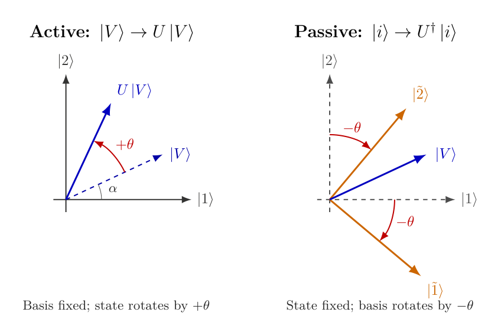

假设 Hilbert 空间的一组基为 $\{ \ket{n} \}$. 如果想要把这组基变成 另一组基 $\ket{m}$, 可以证明，需要一个幺正变换
$$
\ket{m} = U\ket{n}, \quad U^{\dagger}U=I
$$
> [!done]- 表象变换的幺正性（线性代数直接证明）
> 设 $\{\ket{n}\}$ 与 $\{\ket{\tilde{n}}\}$ 为 Hilbert 空间的两组完备正交归一基。定义线性算符 $U := \sum_n \ket{\tilde{n}}\bra{n}$（满足 $U\ket{n} = \ket{\tilde{n}}$），由正交归一性与完备性直接得：
> $$
> U^\dagger U = \sum_{m,n} \ket{m}\braket{\tilde{m}|\tilde{n}}\bra{n} = \sum_n \ket{n}\bra{n} = I, \qquad UU^\dagger = I.
> $$

# 被动变换与主动变换

要指出的是，表象变换在这里的视角是一个 **被动变换**，即物理态不动，换一组基矢来表示。对应的，有 **主动变换** 的概念，就是改变物理态而不改变基矢。直观的理解，可以类比欧氏空间中的转动，转动矢量本身和转动坐标轴的区别：

这两种变换会在符号上产生很大的困扰。比如，我们看这么一个式子：
$$
\ket{\psi'} = U\ket{\psi }
$$
显然，这是一个主动变换，因为物理态从 $\ket{\psi }$ 变成了 $\ket{\psi'}$. 然而有些教科书并不加以区分，在表象变换的章节写这个式子，是不对的。那么，如何表示被动变换，或者说表象变换呢？我们知道物理态不变，但是既然基矢变了，那么力学量的表示肯定要发生变化。

假设我们让空间中的所有矢量 $\ket{V}$ 都做幺正变换 $\ket{V} \to U\ket{V}$，在这种变换下，任一算符 $\Omega$ 的矩阵元被修改如下：
$$
\braket{V'|\Omega|V} \to {\color{blue}\braket{UV'|\Omega|UV}} = {\color{red}\braket{V'|U^\dagger \Omega U|V}}.
$$
很显然，如果我们不管那些矢量，而是使所有的算符都受到该变换的作用，就会发生同样的变化：
$$
\Omega \to U^\dagger \Omega U.
$$
第一种情况被称为 ${\color{blue}\text{active}}$ 变换，而第二种则被称为 ${\color{red}\text{passive}}$ 变换。这种命名方法针对的是矢量——它们在主动变换中发生改变，而在被动情况下则不受影响；如果从算符的角度来看，情况则正好相反。
