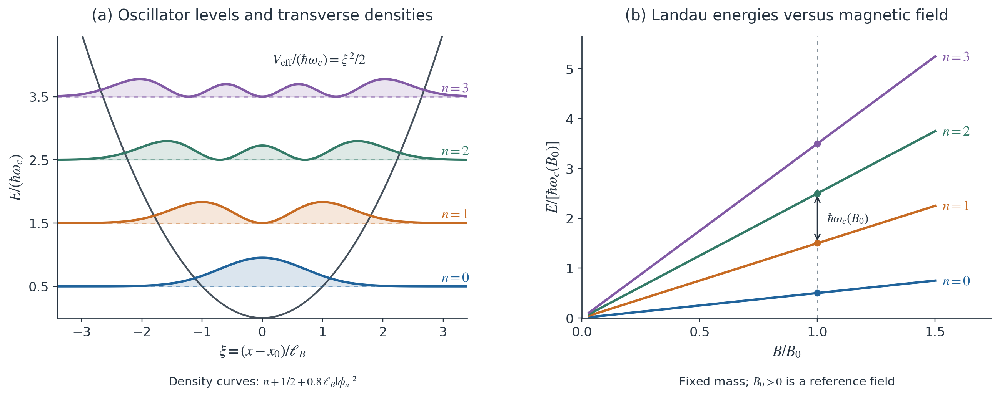
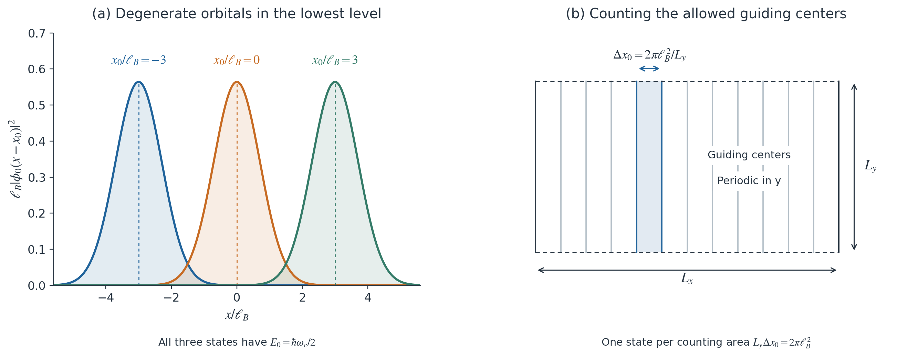

# Basic Model of Landau Levels

全文采用 SI 单位制，电子电荷固定为 $q=-e$，其中 $e>0$。

## 1. 模型假设与哈密顿量

> [!def] 二维电子 Landau 模型、机械动量与最小耦合
> 考虑限制在 $xy$ 平面内的电子，外磁场为静态、均匀且垂直于平面的 $\mathbf B=B\hat{\mathbf z}$，约定 $B>0$。忽略自旋、电子间相互作用、无序与平面内外加标量势，并先求无限平面的体态。质量参数记为 $m$：真空电子取 $m=m_e$；在各向同性抛物线能带近似下，可用有效质量代替 $m$，并将能带底设为能量零点。
>
> 磁场通过满足 $\nabla\times\mathbf A=\mathbf B$ 的矢势 $\mathbf A$ 进入哈密顿量。对于电荷为 $-e$ 的粒子，经典拉格朗日量及其正则动量为
>
> $$
> L=\dfrac12m\dot{\mathbf r}^{\,2}-e\mathbf A(\mathbf r)\cdot\dot{\mathbf r},
> \qquad
> \mathbf p=\dfrac{\partial L}{\partial\dot{\mathbf r}}
> =m\dot{\mathbf r}-e\mathbf A.
> $$
>
> 因此，正则动量 $\mathbf p$ 与机械动量 $\boldsymbol\pi=m\dot{\mathbf r}$ 满足 $\boldsymbol\pi=\mathbf p+e\mathbf A$。量子化后，$\hat{\mathbf p}=-i\hbar\nabla$，最小耦合（minimal coupling）给出
>
> $$
> \boxed{
> \hat H=\dfrac{1}{2m}\bigl[\hat{\mathbf p}+e\mathbf A(\hat{\mathbf r})\bigr]^2
> =\dfrac{\hat\pi_x^2+\hat\pi_y^2}{2m}.
> }
> \tag{1}
> $$

> [!done] 均匀磁场中的机械动量对易关系
> 机械动量的两个分量不再对易。利用[[量子力学/基础与演化/动量和坐标#^prop-3d-commutators|三维对易恒等式]] $[\hat p_i,f(\hat{\mathbf r})]=-i\hbar\partial_i f$，有
>
> $$
> \begin{aligned}
> [\hat\pi_x,\hat\pi_y]
> &=e[\hat p_x,A_y]+e[A_x,\hat p_y]\\
> &=-ie\hbar(\partial_xA_y-\partial_yA_x)\\
> &=-ie\hbar B.
> \end{aligned}
> $$

> [!def] 回旋频率与磁长度
> 该对易关系只依赖磁场，与矢势的具体选择无关。定义两个基本尺度：
>
> $$
> \boxed{
> \omega_c=\dfrac{eB}{m},
> \qquad
> \ell_B=\sqrt{\dfrac{\hbar}{eB}}
> =\sqrt{\dfrac{\hbar}{m\omega_c}}.
> }
> \tag{2}
> $$
>
> $\omega_c$ 是经典回旋运动的角频率大小，$\ell_B$ 称为磁长度（magnetic length）。下文将表明，前者决定能级间隔，后者决定波函数的横向尺度。

## 2. Landau 规范与一维约化

采用 [[场论/Gauge Transformation#Laudau Gauge|Landau 规范]] 的 $\mathbf A=(0,Bx,0)$ 形式，对应本文的 $\mathbf B=B\hat{\mathbf z}$。代入式 (1)，得到

$$
\hat H=\dfrac{1}{2m}
\left[\hat p_x^2+(\hat p_y+eBx)^2\right].
$$

哈密顿量不显含 $y$，故 $[\hat H,\hat p_y]=0$，可以选取二者的共同本征态。为使沿 $y$ 的平面波归一化，先施加周期边界条件 $\psi(x,y+L_y)=\psi(x,y)$，而 $x$ 方向仍取整个实轴。写成

$$
\psi_{k_y}(x,y)=\dfrac{e^{ik_y y}}{\sqrt{L_y}}f_{k_y}(x),
\qquad
k_y=\dfrac{2\pi j}{L_y},\quad j\in\mathbb Z.
$$

代入定态 Schrödinger 方程，得到

$$
\left[
-\dfrac{\hbar^2}{2m}\dfrac{d^2}{dx^2}
+\dfrac{1}{2m}(\hbar k_y+eBx)^2
\right]f_{k_y}(x)=Ef_{k_y}(x).
$$

> [!def] Landau 规范下的轨道中心
> 定义依赖于 $k_y$ 的中心位置
>
> $$
> x_0=-\dfrac{\hbar k_y}{eB}=-\ell_B^2k_y.
> $$

> [!done] 二维 Landau 模型的一维谐振子约化
> 由于 $\hbar k_y+eBx=eB(x-x_0)$，上式化为
>
> $$
> \boxed{
> \hat H(k_y)
> =-\dfrac{\hbar^2}{2m}\dfrac{d^2}{dx^2}
> +\dfrac12m\omega_c^2(x-x_0)^2.
> }
> \tag{3}
> $$
>
> 对于每个固定的 $k_y$，这都是频率为 $\omega_c$、中心位于 $x_0$ 的[[量子力学/典型体系/谐振子#^def-harmonic-oscillator|一维谐振子]]。改变 $k_y$ 只平移中心，因而不改变能谱。这里出现的二次项是机械动能在固定 $p_y$ 子空间中的表达；模型本身没有施加沿 $x$ 的电势阱。平方项已经完整包含 $\hbar^2k_y^2/(2m)$，能量中无需再增加一个沿 $y$ 的自由粒子项。

## 3. 能谱与归一化本征态

### 3.1 能量量子化

> [!def] Landau 能级的升降算符
> 谐振子的代数结构也可以直接由机械动量构造。定义
>
> $$
> \hat a=\dfrac{\ell_B}{\sqrt2\hbar}(\hat\pi_x-i\hat\pi_y),
> \qquad
> \hat a^\dagger=\dfrac{\ell_B}{\sqrt2\hbar}(\hat\pi_x+i\hat\pi_y).
> $$

利用上一节的对易关系与 $eB\ell_B^2=\hbar$，可得

$$
[\hat a,\hat a^\dagger]=1,
\qquad
\hat a^\dagger\hat a
=\dfrac{\ell_B^2}{2\hbar^2}
\left(\hat\pi_x^2+\hat\pi_y^2-e\hbar B\right)
=\dfrac{\hat H}{\hbar\omega_c}-\dfrac12.
$$

于是

$$
\hat H=\hbar\omega_c\left(\hat a^\dagger\hat a+\dfrac12\right).
$$

> [!done] 忽略自旋的二维 Landau 能谱
> 数算符 $\hat a^\dagger\hat a$ 非负，降算符每次将其本征值降低 $1$。可归一化态的下降序列必须终止于 $\hat a\lvert0\rangle=0$，因此数算符本征值为 $n=0,1,2,\ldots$。得到 Landau 能谱
>
> $$
> \boxed{
> E_n=\hbar\omega_c\left(n+\dfrac12\right),
> \qquad n=0,1,2,\ldots
> }
> \tag{4}
> $$
>
> 相邻轨道能级等间距，$E_{n+1}-E_n=\hbar\omega_c$；最低轨道能量为 $E_0=\hbar\omega_c/2$。这些结果对应于均匀磁场下的谐振子约化，也可参见 [TU Delft 课程中的 Landau 能级推导](https://topocondmat.org/w3-pump-qhe/laughlinargument#landau-levels-from-the-hamiltonian)。

### 3.2 波函数与空间尺度

令 $u=x-x_0$、$\xi=u/\ell_B$，式 (3) 成为

$$
\left(-\dfrac12\dfrac{d^2}{d\xi^2}+\dfrac12\xi^2\right)\phi_n
=\left(n+\dfrac12\right)\phi_n.
$$

在该规范下，$\hat a=-i(\partial_\xi+\xi)/\sqrt2$。最低态条件给出 $(\partial_\xi+\xi)\phi_0=0$，故 $\phi_0\propto e^{-\xi^2/2}$。归一化后为

$$
\phi_0(u)=\dfrac{1}{\pi^{1/4}\sqrt{\ell_B}}
\exp\left(-\dfrac{u^2}{2\ell_B^2}\right).
$$

反复作用升算符，并将无关的整体相位吸收进态的定义，得到

$$
\phi_n(u)=
\dfrac{H_n(u/\ell_B)}{\pi^{1/4}\sqrt{2^n n!\ell_B}}
\exp\left(-\dfrac{u^2}{2\ell_B^2}\right),
$$

> [!def] Hermite 多项式
> 其中 $H_n$ 是物理学约定的 Hermite 多项式：
>
> $$
> H_n(\xi)=(-1)^ne^{\xi^2}\dfrac{d^n}{d\xi^n}e^{-\xi^2},
> \qquad H_0=1,\quad H_1=2\xi,\quad H_2=4\xi^2-2.
> $$

> [!done] Landau 规范下的归一化本征波函数
> 因此完整的本征波函数为
>
> $$
> \boxed{
> \psi_{n,k_y}(x,y)
> =\dfrac{e^{ik_y y}}{\sqrt{L_y}}\phi_n(x-x_0),
> \qquad x_0=-\ell_B^2k_y.
> }
> \tag{5}
> $$
>
> 其归一化满足
>
> $$
> \int_0^{L_y}dy\int_{-\infty}^{\infty}dx\,
> \left|\psi_{n,k_y}(x,y)\right|^2=1.
> $$

波函数沿 $y$ 为平面波，概率密度沿 $x$ 局域在 $x_0$ 附近。由谐振子矩阵元可得

$$
\langle x\rangle=x_0,
\qquad
\langle(x-x_0)^2\rangle=\left(n+\dfrac12\right)\ell_B^2.
$$

最低态的横向标准差为 $\ell_B/\sqrt2$，而高能级的宽度随 $\sqrt{n}$ 增大。因此磁长度给出基本长度尺度，但不同 $n$ 的空间分布并不具有相同宽度。单个 $\psi_{n,k_y}$ 是概率密度不随时间变化的定态，其密度图不代表一条经典粒子轨迹。

**图 1｜谐振子约化与 Landau 能谱。** (a) 黑线表示固定 $k_y$ 后的有效二次项，虚线表示 $E_n/(\hbar\omega_c)=n+1/2$。彩色曲线绘制为 $n+1/2+0.8\ell_B|\phi_n|^2$，即在对应能级上叠加经缩放的概率密度，曲线的上移不表示额外能量。(b) 固定质量时，各轨道能级随 $B>0$ 线性变化；$B_0$ 为任意正参考磁场，箭头标出 $B=B_0$ 时的一个能级间隔。图中未包含自旋分裂。

## 4. 导引中心与宏观简并

### 4.1 为什么同一能级对应多个态

式 (4) 只含 $n$，而式 (5) 还含 $k_y$。不同的允许 $k_y$ 对应不同的 $x_0$，但具有相同能量；结合下面的正交性，这些态构成同一能级的 [[量子力学/Hilbert空间/简介#本征态、谱与期望值|简并态]]。

> [!done] Landau 本征态的正交性
> 虽然不同中心的横向波函数可能相互重叠，完整二维态仍然正交：对于周期边界允许的 $k_y,k_y'$，
>
> $$
> \dfrac{1}{L_y}\int_0^{L_y}e^{i(k_y'-k_y)y}\,dy
> =\delta_{j,j'},
> \qquad
> \langle\psi_{n,k_y}\mid\psi_{n',k_y'}\rangle
> =\delta_{n,n'}\delta_{j,j'}.
> $$

> [!def] 导引中心算符
> 为说明这种简并的物理来源，定义导引中心（guiding center）算符
>
> $$
> \hat X=\hat x-\dfrac{\hat\pi_y}{eB},
> \qquad
> \hat Y=\hat y+\dfrac{\hat\pi_x}{eB}.
> $$

在经典运动中，相应的 $X,Y$ 是回旋轨道的中心坐标。量子力学中，它们与机械动量对易。例如

$$
[\hat X,\hat\pi_x]
=[\hat x,\hat\pi_x]-\dfrac{[\hat\pi_y,\hat\pi_x]}{eB}
=i\hbar-i\hbar=0.
$$

> [!done] 导引中心的对易关系与守恒性
> 类似地，$[\hat X,\hat\pi_y]=[\hat Y,\hat\pi_x]=[\hat Y,\hat\pi_y]=0$，从而
>
> $$
> [\hat X,\hat H]=[\hat Y,\hat H]=0,
> \qquad
> [\hat X,\hat Y]=i\ell_B^2.
> $$
>
> 由 [[量子力学/基础与演化/系统随时间的演化|海森堡运动方程]]，$\hat X,\hat Y$ 均为运动常量，但二者不能同时取确定值。在所用 Landau 规范下，
>
> $$
> \hat X=-\dfrac{\hat p_y}{eB},
> \qquad
> \hat X\psi_{n,k_y}=x_0\psi_{n,k_y}.
> $$

因此，$k_y$ 实际上是在标记一个导引中心坐标。Landau 能级的整数 $n$ 标记回旋运动的量子激发，导引中心则提供不改变轨道能量的自由度；二维问题具有一维谐振子能谱并不意味着另一个自由度消失。

### 4.2 每个能级可以容纳多少个轨道态

考虑面积为 $S=L_xL_y$ 的宏观矩形样品，沿 $y$ 仍采用周期边界，并以 $0<x<L_x$ 作为横向范围。先统计中心落在样品内的轨道，忽略边缘对体态的修正。相邻允许波数及其中心的间距大小为

$$
\Delta k_y=\dfrac{2\pi}{L_y},
\qquad
\Delta x_0=\ell_B^2\Delta k_y
=\dfrac{2\pi\ell_B^2}{L_y}.
$$

> [!def] 磁通量、磁通量子与轨道态计数
> 其中 $x_0$ 随 $k_y$ 增大而减小；上式的 $\Delta x_0$ 表示正的间距大小。固定 $n$ 后，每个允许中心给出一个轨道态，故
>
> $$
> N_n\simeq\dfrac{L_x}{\Delta x_0}
> =\dfrac{S}{2\pi\ell_B^2}
> =\dfrac{eBS}{h}
> =\dfrac{\Phi}{\Phi_0},
> \qquad
> \Phi=BS,\quad\Phi_0=\dfrac{h}{e}.
> $$

> [!done] 宏观体态极限下每个自旋分支的 Landau 简并度
> 由此得到宏观体态极限下，**每个 Landau 能级、每个自旋分支**的单位面积轨道态数
>
> $$
> \boxed{
> g_B=\dfrac{1}{2\pi\ell_B^2}
> =\dfrac{eB}{h}
> =\dfrac{B}{\Phi_0}.
> }
> \tag{6}
> $$
>
> 这就是每穿过一个 $h/e$ 的磁通量，每个能级对应一个轨道态的计数关系；它说明简并度正比于样品面积与磁场强度。[相关课程说明](https://topocondmat.org/w3-pump-qhe/laughlinargument#landau-levels-a-microscopic-model-for-the-quantum-hall-effect)。
>
> 有限尺寸下的 $N_n$ 使用近似号有明确原因：中心接近实际边界时，式 (5) 的无限平面波函数不再满足边界条件，能量也会偏离理想的平坦 Landau 能级。对固定 $n$，当样品尺度远大于 $\sqrt{2n+1}\,\ell_B$ 时，上述计数给出体态的主导项；它不等于硬边界样品中严格简并态的精确整数个数。自旋在当前模型中已被省略，因此不自动乘以 $2$。

**图 2｜导引中心的自由度与态数计数。** (a) 三个最低能级态具有不同的中心 $x_0/\ell_B=-3,0,3$，其能量均为 $\hbar\omega_c/2$。(b) 周期边界将允许的导引中心离散化，竖线示意部分允许的 $x_0$；阴影带的计数面积为 $L_y\Delta x_0=2\pi\ell_B^2$。图 (b) 不按实际尺寸比例绘制，竖线不是波函数的边界，阴影面积也不表示互不重叠的电子占据区域。

## 5. 规范选择与物理结果

矢势的规范自由度见 [[场论/Gauge Transformation|规范变换]]。在本文的电子模型中，还需同时变换波函数的相位：

> [!def] 静态规范变换下的电子波函数相位
> 对于与时间无关的函数 $\chi(\mathbf r)$，取
>
> $$
> \mathbf A'=\mathbf A+\nabla\chi,
> \qquad
> \psi'=e^{-ie\chi/\hbar}\psi
> $$

> [!done] 规范变换下能谱与概率密度不变
> 保持磁场不变，并满足
>
> $$
> \bigl(-i\hbar\nabla+e\mathbf A'\bigr)\psi'
> =e^{-ie\chi/\hbar}\bigl(-i\hbar\nabla+e\mathbf A\bigr)\psi.
> $$
>
> 因此对应物理态的能量和概率密度不变。式 (4) 的能谱与式 (6) 的体态计数取决于 $B$，而不取决于规范。对于周期边界，波函数的边界条件也必须随规范变换一致地处理。

Landau 规范的便利在于显式保留沿 $y$ 的平移对称性，使 $k_y$ 成为简并态的标记。其他规范可以选择不同的简并子空间基底；比较不同规范的波函数时，应同时核对它们是否代表同一个物理态。

## 6. 数值尺度与适用范围

以理想二维自由电子为例，取 $m=m_e$、$B=10\,\mathrm T$。由式 (2) 与式 (4)，

$$
\ell_B=\sqrt{\dfrac{\hbar}{eB}}
\simeq8.11\,\mathrm{nm},
\qquad
\Delta E=\hbar\omega_c=\dfrac{\hbar eB}{m_e}
\simeq1.158\,\mathrm{meV}.
$$

前三个轨道能级为 $E_0\simeq0.579\,\mathrm{meV}$、$E_1\simeq1.737\,\mathrm{meV}$、$E_2\simeq2.894\,\mathrm{meV}$。对于 $S=1\,\mathrm{\mu m}^2=10^{-12}\,\mathrm m^2$ 的面积，

$$
g_B=\dfrac{eB}{h}\simeq2.418\times10^{15}\,\mathrm m^{-2},
\qquad
N_n\simeq g_BS\simeq2.42\times10^3.
$$

这里的态数是每个能级、每个自旋分支的体态估计。若将质量改为有效质量 $m^*$，相同磁场下的能级间隔按 $m_e/m^*$ 缩放，而磁长度和单位面积轨道态数不变。

本模型的离散能谱对应垂直磁场方向的轨道运动。若允许沿 $z$ 方向自由运动，则增加 $\hbar^2k_z^2/(2m)$，三维总能量不再只有离散值。真实电子的自旋还会引入 Zeeman 能量，无序、边界及电子间相互作用则会改变上述理想谱或态结构。这里得到的单粒子轨道能谱与简并度，是进一步讨论磁场中电子体系的起点；量子 Hall 输运需要额外分析占据情况和电流响应。

## 参考与配图复现

1. [[量子力学/基础与演化/动量和坐标|动量和坐标]]；[[量子力学/典型体系/谐振子|谐振子]]；[[量子力学/基础与演化/系统随时间的演化|系统随时间的演化]]。
2. TU Delft, *Topology in condensed matter: tying quantum knots*, [Quantum Hall effect: pumping electrons in Landau levels](https://topocondmat.org/w3-pump-qhe/laughlinargument)，其中 “Landau levels from the Hamiltonian” 给出规范选择与谐振子约化。不同资料可能采用不同的电荷记号与坐标方向；本文统一采用 $q=-e$、$\mathbf A=(0,Bx,0)$。

两组配图均由本文解析式生成，可复现代码为 [plot_landau_levels.py](assets/plot_landau_levels.py)，依赖 NumPy 与 Matplotlib；运行脚本即可在同目录生成 PNG 与 SVG。矢量图见 [图 1 SVG](assets/landau_spectrum.svg) 和 [图 2 SVG](assets/landau_guiding_centers.svg)。
